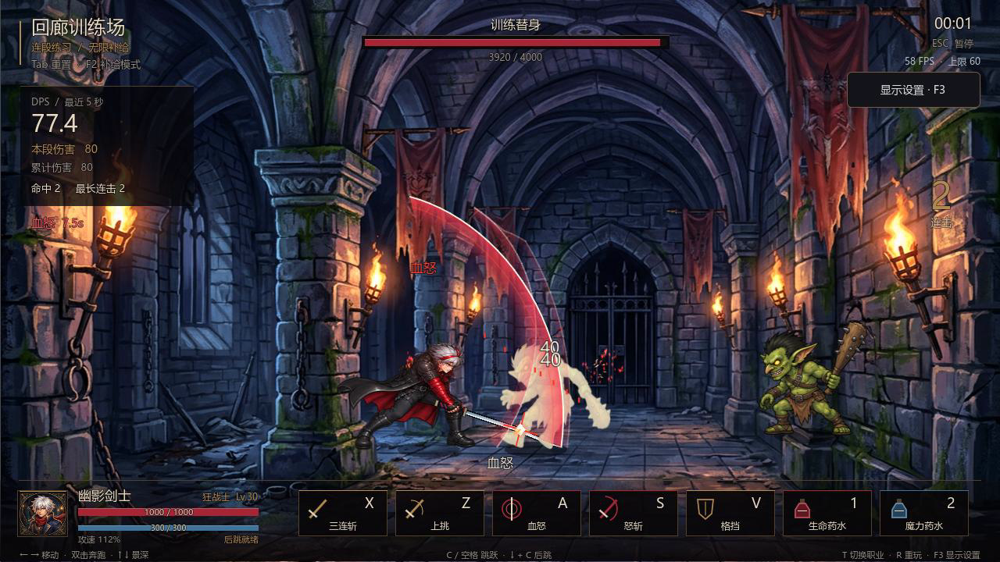

# 幽暗回廊 · DNF-like

原创手绘风单机横版动作 RPG，Godot 4.7.2。当前交付**战斗 demo v4**：保留三波遭遇、双转职与连段训练，按试玩反馈打磨待机/后跳、双击奔跑衔接、更高跳跃与标准攻速，加入曲线月牙刀光、原生粒子、更强受击表现和 F3 帧率设置。身体与武器继续独立。

## 双工作区与美术设计入口

- 两边 Agent 开工先读 [AGENTS.md](AGENTS.md)，完成相关产出后自动提交并推送；接收区先同步再接入，不覆盖他人修改。
- 当前工作区先继续设计，另一工作区承担实装。共享规范见 [美术全流程](docs/design/14_美术资源全流程.md)、[统一风格与题材](docs/design/15_统一风格与题材规范.md)、[资源总清单](docs/design/16_美术资源总清单.md)、[任务模板](docs/design/17_美术资源任务模板.md)。
- V6四招和配套效果已获预览认可、尚未实装：[资源与接入待办](docs/design/13_V6动作资源与实装待办.md)，预览位于 `docs/previews/v6_art/`。可玩工程仍是下方V4版本。

## 开始试玩

```powershell
# 本机已有 Godot 时直接运行
powershell -NoProfile -ExecutionPolicy Bypass -File tools/run_demo.ps1

# 新机器先安装引擎，再按上一步启动
powershell -NoProfile -ExecutionPolicy Bypass -File tools/setup_godot.ps1
```

也可以用 Godot 打开 `game/project.godot` 后按 F6/F5 运行主场景。自备引擎可向启动脚本传入 `-GodotPath "C:\path\godot.exe"`。正式贴图和 WAV 已入库，首次拉取无需安装 Python 或重新烘焙；启动脚本会完成 Godot 导入。

选择职业后点**连段训练**，可以在两个保留浮空、倒地与受身反应的训练目标上练习。默认无限魔力与职业技能补给，上挑和后跳始终保留基础冷却。HUD 显示最近 5 秒 DPS、本段/累计伤害和最长连击；流血也计入伤害。点三波挑战则进入完整遭遇战。

[V4 实机演示（含音效）](docs/previews/combat_v4_showcase.mp4) · [12 点反馈的实现与验收](docs/2026-10-14_战斗DemoV4_反馈修正与帧率设置.md)



## 操作

| 按键 | 动作 |
|---|---|
| ← / → | 行走；双击同方向奔跑 |
| ↑ / ↓ | 调整地面纵深，攻击需要对齐敌人所在纵深 |
| X | 地面三连；跑动时冲斩接后两段；空中下劈，每次起跳最多两次 |
| Z | 上挑，冷却 2 秒；命中后按 C 起跳，空中 X 追击 |
| C / 空格 | 跳跃；轻点小跳，按住完整跳跃，奔跑起跳保留惯性 |
| ↓ + C | 后跳，起手有短暂无敌，冷却 0.35 秒 |
| V | 正面格挡减伤 80%；起手 3 帧精准格挡减伤 95% |
| A / S | 狂战士：血怒 / 怒斩；剑魂：拔刀斩 / 连突刺 |
| 1 / 2 | 生命 / 魔力药水，共享 5 秒冷却 |
| Esc / F1 | 暂停 / 操作说明 |
| R / T | 重玩 / 切换职业试玩 |
| Tab / F2 | 训练重置 / 切换无限补给与实战蓝耗冷却 |
| F3 / 右上角显示设置 | 帧率上限与垂直同步，设置立即生效并在本机保存 |

奔跑只使用同向双击，Shift 功能已移除。攻击期间也能提前双击并按住方向，在允许移动的收招阶段直接跑出；跑动反向时保留奔跑意图，持续松键则停稳。普通攻速为 **100%**，用更长的准备与收势建立标准节奏，血怒加成为 12%；属性独立于帧率。完整跳跃约 173 px，轻点仍为短跳。

**设置帧率：**按 F3 → 选择 30 / 60 / 90 / 120 / 144 / 165 / 240 FPS 或不限 → 按需要切换垂直同步 → 完成。右上角显示当前 FPS；垂直同步可能让实际帧率受显示器刷新率限制。战斗中打开菜单会暂停，关闭后继续。

M1 双转职各提供两个代表技能，D/F/G/H 尚未开放。最后一波含哥布林队长。当前武器已完全独立于身体 PNG，并预留 profile 与逐帧握点；装备穿戴与玩家换武器界面留待装备系统。

## 验证与资源重建

```powershell
# 123 项战斗与集成检查
powershell -NoProfile -ExecutionPolicy Bypass -File tools/run_demo.ps1 -Test

# 真实渲染截图：标题、场景、命中、训练和设置 → temp/demo/
powershell -NoProfile -ExecutionPolicy Bypass -File tools/run_demo.ps1 -Capture

# 同时在真实渲染器中跑回归并保存真实三波通关结算截图
powershell -NoProfile -ExecutionPolicy Bypass -File tools/run_demo.ps1 -Test -Capture

# 仅修改美术/音频源时需要 Python 工具链
python -m pip install -r requirements.txt
python tools/bake_body_v3.py
python tools/bake_body_v4.py
python tools/bake_combat_audio.py
```

123 项检查包含攻击/停帧中的双击跑、左右跑动反转、近距离冲斩命中后接第二/第三击、跳跃四阶段、暂停中松键短跳、基础技能冷却、真实曲线刀光、原生粒子/形变冻结与重置，并回归此前连段、技能、训练统计与完整通关。真实渲染、无缓存新副本、30/120 FPS 渲染步长均通过；物理固定 60 Hz，启用物理插值。回归静音但验证资源，普通试玩与录像保留音效。`-Test` 同时检查引擎错误、完成标记和退出码。

主角使用内置 imagegen 的无武器身体源图：V4 新增 24 个独立源姿势，待机、后跳、跳跃各 8 帧，并细分跳跃阶段；保留 V3 的 17 个其它动作，共 24 个播放片段，阶段片段复用同一套跳跃姿势。逐帧握点与阶段映射由烘焙工具校验，武器在 Godot 中独立绘制。普攻、技能和 buff 接入软边纹理的原生 `CPUParticles2D`，最多 20 个发射器、每个 28 粒。音频沿用 27 事件 × 3 变体的 81 个原创 PCM16 WAV。完整源图/提示词见 [V4 身体动画](art/sheets/v4/README.md)、[V3 战斗动作](art/sheets/v3/README.md)，配方/试听见 [拟音记录](audio/combat_v3/README.md)。

实机录像可复现：在 Godot 的 `--write-movie` 参数传入仓库内 `temp/v4_showcase.avi` 的**绝对路径**，再传 `--fixed-fps 60 -- --showcase`；完成后运行 `python tools/export_showcase.py --version v4` 导出 MP4。录像驱动使用真实游戏输入与战斗系统。

## 工程内容

- `game/scripts/`：战斗、AI、训练、HUD、武器层、特效、音频与回归。
- `game/data/`：动作帧表、技能、属性、武器 profile 与三波遭遇配置。
- `game/assets/actors_v3/`：无武器主角帧条、逐帧握点和阶段元数据。
- `game/assets/actors_v4/`：待机/后跳/跳跃新增片段，当前动画入口。
- `game/assets/audio_v3/`：正式拟音 WAV，保留无损导入。
- `game/assets/demo/`：怪物、背景、头像与上一轮资产。
- `art/characters/`：已确认角色参照；主角唯一造型标杆为 `hero_cool.png`。
- `art/sheets/v3/`、`art/sheets/v4/`、`audio/combat_v3/`：源文件、生成记录、校准与审核资料。
- `docs/design/`：设计；`docs/previews/`、`docs/screenshots/`：实际游戏证据。
- `tools/`：安装、启动、烘焙与录像导出。

基础 guard/受击空中保持姿势和三段刺击仍有记录在案的有限复用，可沿当前分层管线补专用动作。自动检查验证功能稳定性，最终动作与音色品质仍需试玩评估。

旧 `game/art/` 继续作为被忽略的占位烘焙目录，demo 不再依赖它。`render_preview.py` 是历史手感验证器，不能用它的旧造型覆盖正式美术。`temp/`、`tools/godot/`、`game/.godot/` 不入库；设计结论与正式资源随 Git 提交。
