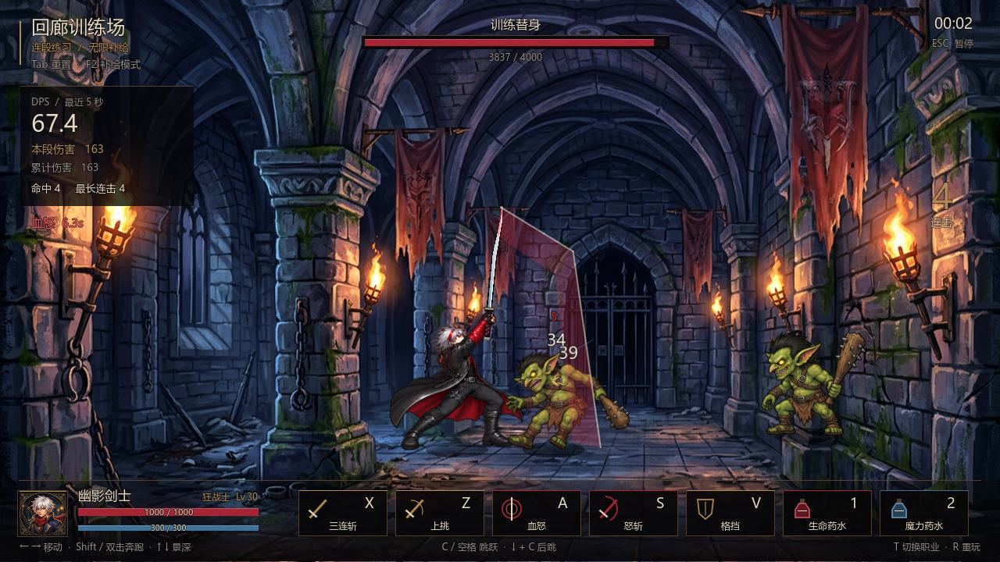

# 幽暗回廊 · DNF-like

原创手绘风单机横版动作 RPG，Godot 4.7.2。当前交付**战斗 demo v3**：保留三波遭遇战、双转职与胜负重玩，新增连段训练、无武器身体动画、独立长刀、跑动与空中连段、真实刀尖轨迹和分层拟音。

## 开始试玩

```powershell
# 本机已有 Godot 时直接运行
powershell -NoProfile -ExecutionPolicy Bypass -File tools/run_demo.ps1

# 新机器先安装引擎，再按上一步启动
powershell -NoProfile -ExecutionPolicy Bypass -File tools/setup_godot.ps1
```

也可以用 Godot 打开 `game/project.godot` 后按 F6/F5 运行主场景。自备引擎可向启动脚本传入 `-GodotPath "C:\path\godot.exe"`。正式贴图和 WAV 已入库，首次拉取无需安装 Python 或重新烘焙；启动脚本会完成 Godot 导入。

选择职业后点**连段训练**，可以在两个保留浮空、倒地与受身反应的训练目标上练习。默认无限魔力与技能补给，HUD 显示最近 5 秒 DPS、本段/累计伤害和最长连击；流血也计入伤害。点三波挑战则进入完整遭遇战。

[实机演示（10.7 秒，含音效）](docs/previews/combat_v3_showcase.mp4) · [本轮实现与验收](docs/2026-10-14_战斗DemoV3_武器分层与手感打磨.md)



## 操作

| 按键 | 动作 |
|---|---|
| ← / → | 行走；双击同方向奔跑 |
| Shift + ← / → | 按住奔跑 |
| ↑ / ↓ | 调整地面纵深，攻击需要对齐敌人所在纵深 |
| X | 地面三连；跑动时冲斩接后两段；空中下劈，每次起跳最多两次 |
| Z | 上挑；命中后按 C 起跳，空中 X 追击 |
| C / 空格 | 跳跃；轻点小跳，按住完整跳跃，奔跑起跳保留惯性 |
| ↓ + C | 后跳，起手有短暂无敌 |
| V | 正面格挡减伤 80%；起手 3 帧精准格挡减伤 95% |
| A / S | 狂战士：血怒 / 怒斩；剑魂：拔刀斩 / 连突刺 |
| 1 / 2 | 生命 / 魔力药水，共享 5 秒冷却 |
| Esc / F1 | 暂停 / 操作说明 |
| R / T | 重玩 / 切换职业试玩 |
| Tab / F2 | 训练重置 / 切换无限补给与实战蓝耗冷却 |

M1 双转职各提供两个代表技能，D/F/G/H 尚未开放。最后一波含哥布林队长。当前武器已完全独立于身体 PNG，并预留 profile 与逐帧握点；装备穿戴与玩家换武器界面留待装备系统。

## 验证与资源重建

```powershell
# 83 项战斗与集成检查
powershell -NoProfile -ExecutionPolicy Bypass -File tools/run_demo.ps1 -Test

# 真实渲染截图：标题、场景、命中和训练 → temp/demo/
powershell -NoProfile -ExecutionPolicy Bypass -File tools/run_demo.ps1 -Capture

# 同时在真实渲染器中跑回归并保存真实三波通关结算截图
powershell -NoProfile -ExecutionPolicy Bypass -File tools/run_demo.ps1 -Test -Capture

# 仅修改美术/音频源时需要 Python 工具链
python -m pip install -r requirements.txt
python tools/bake_body_v3.py
python tools/bake_combat_audio.py
```

检查覆盖连段、命中/空挥取消、跳跃与跑动转换、精准格挡、浮空/受身、武器镜像/挂点/触及范围、命中首帧刀光、死亡重玩、训练统计与完整通关。真实渲染、无缓存新副本、30/120 FPS 渲染步长均为 83 项通过；物理固定 60 Hz。回归静音但验证资源，普通试玩与录像保留音效。`-Test` 同时检查引擎错误、完成标记和退出码。

主角使用内置 imagegen 制作的无武器身体源图：20 动作、73 个独立源姿势，八个核心动作各 8 帧。逐帧握点与阶段映射由烘焙工具校验，真实武器在 Godot 中独立绘制；音频为本工程离线程序化拟音，27 事件 × 3 变体，共 81 个 PCM16 WAV。源图、完整提示词与有限复用说明见 [身体动画记录](art/sheets/v3/README.md)，音色配方、试听和数值校验见 [拟音记录](audio/combat_v3/README.md)。

实机录像可复现：在 Godot 的 `--write-movie` 参数传入仓库内 `temp/v3_showcase.avi` 的**绝对路径**，再传 `--fixed-fps 60 -- --showcase`；完成后运行 `python tools/export_showcase.py` 导出 MP4。录像驱动使用真实游戏输入与战斗系统。

## 工程内容

- `game/scripts/`：战斗、AI、训练、HUD、武器层、特效、音频与回归。
- `game/data/`：动作帧表、技能、属性、武器 profile 与三波遭遇配置。
- `game/assets/actors_v3/`：无武器主角帧条、逐帧握点和阶段元数据。
- `game/assets/audio_v3/`：正式拟音 WAV，保留无损导入。
- `game/assets/demo/`：怪物、背景、头像与上一轮资产。
- `art/characters/`：已确认角色参照；主角唯一造型标杆为 `hero_cool.png`。
- `art/sheets/v3/`、`audio/combat_v3/`：源文件、生成记录、校准与审核资料。
- `docs/design/`：设计；`docs/previews/`、`docs/screenshots/`：实际游戏证据。
- `tools/`：安装、启动、烘焙与录像导出。

基础 idle/guard/air 和三段刺击仍有记录在案的有限姿势复用，后续可以沿当前分层管线补专用动作。自动检查验证功能稳定性，最终动作与音色品质仍需试玩评估。

旧 `game/art/` 继续作为被忽略的占位烘焙目录，demo 不再依赖它。`render_preview.py` 是历史手感验证器，不能用它的旧造型覆盖正式美术。`temp/`、`tools/godot/`、`game/.godot/` 不入库；设计结论与正式资源随 Git 提交。
