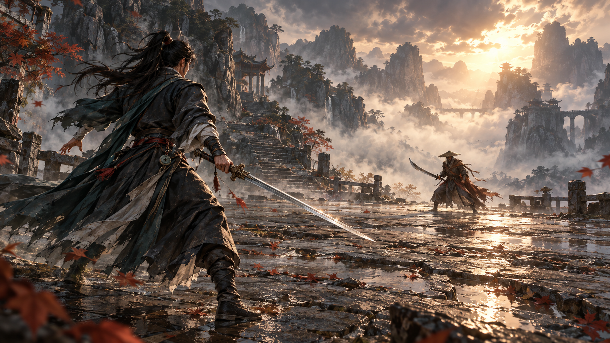
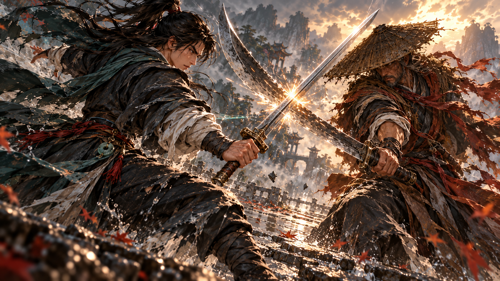

# 武侠战斗构图样图 V2

2026-10-14。状态：`source_review`，**两张候选概念图已生成，待用户评审，未实装**。本轮按用户对 V1 的五项反馈迭代，供画风、角色、构图和拼刀力量感评审。

2026-10-14 后续反馈：用户肯定帅气，但认为 AI 味重、细节过多、不像游戏画面；已制作 [V3 简化候选](wuxia_backview_v3.md)，保留侠客与对抗，改以较简洁的大形和明暗评审。V2 保留作为历史对照，未获整套风格批准。

## 身份、需求与影响

| 字段 | 本轮约定 |
|---|---|
| task_id / revision | wuxia_backview / v2 |
| asset_id | concept.battle.rear_view.idle；concept.battle.rear_view.weapon_parry |
| 类型 / 路线 | 静态概念图；美术全流程 A/F 组合样张 |
| 风格 / 题材 | 候选 wuxia_painterly_cinematic_v2 / wuxia_ink_v1，尚未获批准 |
| replaces | V1 的概念方向迭代，旧图保留用于对比 |
| 数量 / 用途 | 对峙、拼刀各一张，验证角色气质、空间比例与接触瞬间 |
| 制作工作区 | D:/dnf like/dnflike，用户本轮明确分配概念图修改 |
| 实装负责人 | 尚未分配本概念方向实装任务 |

用户反馈：减少卡通感，主角更酷、帅、飘逸且有侠客气质；构图比例参考用户提供的《33号远征队》截图；对峙使用持剑准备姿势；拼刀允许改变镜头、推近、特写，必须有力量、张力与对抗。

## 参考与真实输入

- `art/concepts/wuxia_backview_v2/reference_composition.png`：用户提供的游戏截图，仅参考近景主角/中远景敌人的尺度、背后机位和纵深空地。它不是本项目原创素材，不用于实装，也不复制角色、UI、标识或环境设计。
- 对峙图：将上述截图实际传入内置 imagegen 的 `referenced_image_paths`；以成熟半写实二维绘画、彩色水墨气氛重新设计原创武侠人物和场景。
- 拼刀图：已将本轮选用对峙图实际传入 `referenced_image_paths`，作为角色/衣装/场景连续性参考；镜头改成近景对抗，实际调用结果写入 `generation.json`。
- V1 是反馈对照，未作为本轮生成器的画风输入，避免继承用户指出的粗描边与卡通人物。
- 内置生成器的模型版本与随机种子未暴露，不声称固定种子或跨图严格一致。完整实际提示词、参考输入与输出记录保存在资源目录。

## 视觉规格与验收点

对峙：16:9 背后三分之四机位，主角左侧近景约占画面高度 68–72%，敌人在中间偏右约占 22–27%；中间留清楚战斗空地。主角沉腰、屈膝、髋肩微拧，单手持剑低位前向戒备，长衣与头发有风向，身体有稳定承重。

拼刀：允许独立低机位三分之四近景与轻微镜头倾斜。双方向交刃点形成相反施力，肩肘、髋肩和步伐传达顶住冲击的重量。剑柄、握持、护手、剑刃连续，一人一把武器，局部火星集中在实际交刃处。

共同画风：成熟、修长的原创侠客，真实布料与金属形体，克制装饰、深墨青衣与少量朱砂点缀；精细二维绘画边缘和明暗，彩色水墨空间。无粗黑卡通描边、幼态大头、UI、文字、水印或多余武器。目标宽屏 16:9，实际尺寸在生成后记录；背景不透明。本轮没有运行时锚点、分层、帧序、事件或播放契约。

## 制作与交付

- 源图/完整记录：`art/concepts/wuxia_backview_v2/`。
- 评审副本：`docs/previews/wuxia_backview_v2/`，从选用源图直接复制；不对图像进行脚本修补。
- 技术核查：两张均为实际 **1672×941 RGB PNG**，背景不透明；System.Drawing 解码成功，源/预览 SHA256 一致。未缩放、裁切、量化或脚本修补，逐张直接看生成器原图检查人物、武器、构图与接触。
- 生命周期：方向评审通过后才确定后续角色一致性板、短序列与分层方案；本轮静态图不能证明运镜、拼刀动作或新题材已经实装。
- 受影响下游：若批准，需重评背视角色动作、镜头切换、场景纵深、接触判定、FX与UI；不能直接用这两张图替换 V4/V6 帧图。
- 发布：按 AGENTS 自动提交并推送本轮相关源图、预览与记录；待用户评审，不继承 V6 的动作认可。

## 结果与后续

- [x] 两张选用概念图完成，给出准确本地路径并显示。
- [x] 人工视觉核查及格式/源预览一致性记录完成。
- [ ] 用户认可或指定下一轮调整。
- [ ] 认可后再安排同角色姿势/接触前后短序列验证。
- [ ] 明确实装任务后再进入 Godot 接入与实机验收。

## 评审入口与本轮变化

本工作区目录：`D:/dnf like/dnflike/docs/previews/wuxia_backview_v2/`。

| 预览 | 变化 |
|---|---|
| [idle_standoff.png](../previews/wuxia_backview_v2/idle_standoff.png) | 背后三分之四近景，侠客沉腰低位持剑，近大远小、风中衣发与山间逆光 |
| [weapon_parry.png](../previews/wuxia_backview_v2/weapon_parry.png) | 低位近景、倾斜构图，两人肩臂承压，交刃处集中金属火星，主角侧脸可见 |

完整提示词、真实图像输入、两次内置 imagegen 调用产物、尺寸和哈希见 `art/concepts/wuxia_backview_v2/generation.json`。截图使用的是用户本轮上传附件，已另存持久参考副本；将来复用应传入仓库中的副本，不依赖上传时的临时路径。

## 已知限制与批准范围

- 对峙生成结果的主角约占画面高度 85%、敌人约 18%，比最初 68–72% / 22–27% 数值目标更强调近景主角。保留为本轮候选，不声称完全复刻截图比例。
- 人物质感更偏写实绘画，水墨主要体现在山雾、层次和用色。是否达到用户想要的帅、飘逸与惊艳程度，仍由本轮评审判断。
- 两张图虽然真实使用了同轮参考图，脸、布料褶皱、武器细节和背景不能视为已锁定的严格角色一致性方案。
- 拼刀是一次接触瞬间的静态构图，脚部不在近景画幅内；不能据此证明完整步伐、受力连续帧、运镜或游戏碰撞已经成立。
- 本轮没有源图认可、动画、分层资产或实机批准。若方向认可，下一步先做角色标准板和拼刀前摇/接触/回弹的小序列，而非直接量产全游戏。
