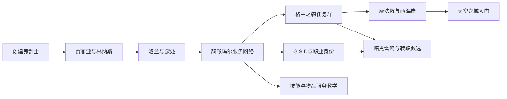

# DNF前期任务、城镇与NPC设计拆解

> 适用game_dnf后续内容实装；本轮交付设计与原包证据，不改游戏逻辑。
> 范围：鬼剑士创建后到首次转职及天空之城入门，调查窗口为任务最低等级1～20。等级相互重叠，不是固定升级时刻表。

## 一、共用入口

| 文档 | 解决的问题 |
|---|---|
| [任务与成长路线](30_前期任务城镇与NPC设计_任务.md) | 原任务ID/前置、章节、任务目标、支线与职业引导 |
| [城镇与NPC](30_前期任务城镇与NPC设计_城镇与NPC.md) | 空间分工、NPC服务、资源组成、位置变体与交互表现 |
| [实装与验收](30_前期任务城镇与NPC设计_实装与验收.md) | 数据、任务状态、跨区接口、存档迁移、分批交付与验收 |
| [本轮取证记录](../reports/ws2/2026-10/2026-10-23_前期任务城镇NPC取证.md) | 真实读取范围、来源哈希、可复现命令和未确认项 |
| [原始字段快照](../reports/ws2/2026-10/2026-10-23_前期世界原包字段.json) | 任务/NPC/城镇/地图/副本索引与字段，保留重复标签和本地化引用 |

沿用[26证据规则](26_DNF原版拆解_证据与版本.md)、[27流程事务](27_城镇副本战斗闭环.md)、[28分工](28_工作区分工与原版资料共享.md)和[29接口](29_新版工程框架_接口契约.md)。本页只规定前期内容，不覆盖战斗内核规则。

## 二、先区分三个层次

| 层次 | 本轮结论的含义 | 后续使用方式 |
|---|---|---|
| 原包事实：E-FILE/E-PARSE | 共享备份PVF包含某任务、字段、索引、文字和NPC/地图记录 | 作为待转换输入；可以查来源，不代表实际运行激活 |
| 设计解释：E-INFER | 从任务依赖、服务类型和地图结构解释引导意图 | 指导设计与实验；保留反证入口 |
| 本地工程方案：E-ADAPT | 如何在Godot组织任务、城镇、UI与可靠存档 | 可以开发；使用独立语义ID，不伪称原版内部实现 |

首要参照仍是用户的“情怀60复古”。当前提取库为备份配置，生效PVF与地图变体未锁定；包内有跨年代、定制和未索引内容。不能因目录叫Elvengard或最低等级为1就全部启用。

旧[08城镇与任务](08_城镇与任务.md)是game旧工程的原创单城方案。本组文档是game_dnf的原版内容研究，两者适用范围不同；不把旧工程的“一个主城/任务板”限制套到新版。

## 三、前期的设计骨架

核心循环是：**认识一个人 → 获得明确目标 → 带着目标进入副本 → 在战斗中掌握一种能力 → 回城看到成长 → 接触新的服务和区域。**

城镇承担安全、社交叙事和资源整理，地下城承担危险、练习和获取；NPC把两者连起来。任务既是剧情，也是地图导航、功能教学与成长配速的载体。以上是对本轮原任务网络的设计解释，不是客户端代码结论。

| 阶段 | 原记录依据 | 主要体验与设计职责 | 实装边界 |
|---|---|---|---|
| 创建后的落点 | 任务101/1016、NPC2赛丽亚与NPC1林纳斯 | 给新角色一个熟悉、安全的返回点，再介绍镇外目标 | 是否先经过“救赛丽亚”战斗教学，本轮未确认；不自动补写成原版既定开场 |
| 艾尔文防线与洛兰 | 101→102→103→4301；洛兰/深处 | 交谈、进入副本、通关、定量击杀、返城交付；练习完整小循环 | 首批用原洛兰和洛兰深处；现有五房密林试炼是样板，不能冒名顶替两个原副本 |
| 赫顿玛尔与格兰之森 | 104之后的共通/鬼剑士分支 | 从一个教练式NPC扩展到商人、导师和居民网络；服务逐渐增加 | 不把所有服务都塞回林纳斯，也不在第一次进城弹出全部教学 |
| 森林的变化与调查 | 雷鸣、猛毒、冰霜、烈焰、暗黑相关任务 | 从熟悉怪物到不同威胁，再用NPC解释异常并推动换区域 | 怪物机制须由ws1按原数据支持，不能仅换背景或提高血量冒充新副本 |
| 职业身份与更大世界 | G.S.D职业线、18级转职候选、16～20级西海岸任务 | 明确“我是鬼剑士”与后续发展方向，引入魔法阵、天空之城 | 本轮只保留未来转职接口；当前创建仍固定鬼剑士，未实现四转职 |

三条轨道交织推进：共通剧情解释世界，职业线建立角色身份，生活/系统任务教会补给、技能、分解等操作。不能把它们压成一条“杀完本关自动领奖”的线。

此图表达体验关系，不代替逐任务前置图；不能按箭头顺序强制所有支线完成。

## 四、值得保留的设计手法

| 手法 | 原记录里的体现 | 对后续实装的要求 |
|---|---|---|
| 小目标带出新空间 | 101拜访林纳斯、104引向风振、112把物品带给索西雅 | 提供人物、地区和行动信息；玩家能在场景里找到目标 |
| 同一场景有多个用途 | 森林主线、职业线与居民收集/击杀任务复用副本 | 可并行接取和跟踪；按事件分别计数，不共用一个全局任务状态 |
| 威胁逐步具体化 | 普通哥布林/牛头兽、猫妖、凯诺、毒猫王、魔法师、亡者 | 每次换目标应当带来辨识度和新的应对点；仅换名字不算内容完整 |
| 整备有情境 | 林纳斯的初次帮助、G.S.D试验/新武器、诺顿分解任务 | 奖励装备与新能力应能实际使用，教学动作和任务判定相连 |
| 人物有稳定身份 | 林纳斯铁匠、G.S.D导师、索西雅酒馆、诺顿分解、凯丽强化 | 对白口吻、环境与服务菜单一致，不用一套无差别商店窗口表达全部NPC |
| 区域叙事升级 | 林地异变转向精灵魔法阵与天空之城 | 新地图伴随新问题、新NPC关系和新素材，不只是换副本列表 |

“每次新增一个学习重点”“保留熟悉的返回点”是本地编排建议；本轮没有原版单次教学耗时、平均通关次数或经验曲线测量，不编造分钟数和精确升级节奏。

## 五、当前工程与目标的距离

当前已具备选人/建角、艾尔文防线、林纳斯对话、购买、装备/背包、一个适配任务、出征、五房战斗、结算和独立角色存档。
现有Session.profile.quest只有一个状态值，NPC交互和内容较固定；不能直接容纳原任务图。它验证的是基础循环，尚未实现本页描述的前期内容网络。

后续第一目标建议是：**原洛兰/洛兰深处 + 赛丽亚/林纳斯 + 101/102/103/4301 的可保存任务小闭环**。先把这一小段的原图、实际目标、NPC交付、奖励和异常恢复做好，再扩赫顿玛尔和职业/服务线。

最后再扩格兰之森支线、暗黑雷鸣/转职、西海岸。各阶段可用同一套数据和UI扩充，不为每条任务新写专属面板或独立存档逻辑。

## 六、本轮明确留下的取证问题

1. 实际启动配置与NPC/地图变体：部分TWN引用在库中没有同名MAP，不能自动选相似变体补齐。
2. 实际激活任务：有文件不等于进入quest.lst；进入索引也不等于服务端一定开放。
3. 原包18级单关转职候选与20级多步骤历史文件并存，不能把两套拼为一条任务。
4. 原文难度称呼、数值门槛与现版普通/冒险/王者三档的映射需要单独核对。
5. 对话和奖励需要按源键/职业/状态解析；金币、经验、掉落率、消耗和开图规则尚未全部确认。
6. 赛丽亚入口、开场教学、引导标记和剧情表现应补同条件原客户端录像；现有素材和文字不能替代运行证据。

本组文档状态为设计/取证已发布、实装与用户体验验收待进行；不得在其它区接入前替对方登记完成。
