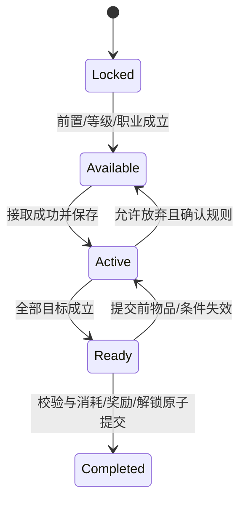

# 前期设计：后续实装与验收规格

入口：[前期总览](30_前期任务城镇与NPC设计.md)。本页是E-ADAPT开发方案，不声称现有工程已具备下列通用任务系统。

## 一、先建立数据层，保留现有可玩入口

沿用[29分层](29_新版工程框架.md)：原档解析→标准内容→任务/世界服务→表现。原任务ID与源路径保留在source中，运行语义ID独立，不用显示名或数组位置作存档主键。

建议内容种类：quest_definition、quest_chapter、npc_definition、npc_service、town_definition、town_connection、dungeon_definition、dialogue_node与reward_definition。定义与角色进度分离，原数据与自定义覆盖分开。

| 数据 | 至少需要的字段 |
|---|---|
| QuestDefinition | id、source原ID/路径/SHA、版本范围、职业/成长条件、最低等级、前置表达式、接取/交付NPC、目标列表、固定/可选奖励、文本键、追踪提示、处理器版本、unsupported |
| QuestObjective | objective_id、type、目标语义ID、原参数、数量、上下文条件、是否追认已持有物品/过往事实、去重规则、完成处理器 |
| QuestProgress | 状态、各目标进度、接取标记、奖励选择、交付事务ID、内容版本；只有角色进度，不复制定义全文 |
| NPCDefinition | 稳定ID、原NPCID、中文名键、角色定位、field ANI、肖像、默认对白、任务入口、服务能力列表 |
| TownDefinition | 地区/area/MAP标识、源变体与选择依据、走区、NPC安置、出口/目标/落点、镜头、资源依赖 |
| RewardDefinition | 实际金币/经验/物品/职业变化等分项、条件/选择项、容量处理、来源/适配标记 |

不直接把本轮取证JSON当运行内容包。它含历史候选、未知目标参数、可能矛盾的文本和未认证地图变体；正式内容包先有白名单与处理器覆盖报告。

## 二、任务状态与事务

这是本地状态模型。原版可接数量、放弃行为、隐藏任务和自动完成任务另有策略，不从图中推导为已还原规则。

交付必须一次性完成：重新校验角色/任务/材料/容量→消费→发固定与选中奖励→标记完成→解锁后继→写同一个角色快照。任何一步失败都不能只扣材料或只发金币。

提交ID建议由角色ID、任务ID和可重复任务的周期实例组成。掉落/击杀目标则按run_id、room_id、entity_id与事件序号去重；二者不能混成同一个“已结算Run”布尔值。

未解释的原目标或奖励类型必须明确报unsupported；不能把未知条件当true、把任务空目标当自动完成，或把负数转成0后继续执行。

## 三、目标处理器先做哪几种

| 类型 | 适用源任务例 | 第一版所需能力 | 不能省略 |
|---|---|---|---|
| meet npc | 101/104/4301/501 | 特定NPC的真实对话/交付事件 | 走近NPC不等于已对话；不同接取/完成NPC |
| hunt monster | 103/105/106/108 | 杀死指定怪物并按任务/上下文计数 | 接受时机、同怪多任务、事件重发、难度和副本条件 |
| condition under clear | 102/116/503/转职候选 | 指定地下城及已解释子条件的成功结算 | 完整副本而非普通房间结束；失败/撤退不算；原难度映射 |
| seeking | 110/112/材料任务 | 查库存/任务物品与原子交付 | 有物品不等于已消费；是否可先收集后接任务需策略 |
| clear map | 4601/4307等 | 特定地图/事件完成证据 | 与整个地下城通关不同；特殊NPC/演出依赖不能跳过 |
| custom quest | 211/212 | 对每个原自定义参数的明确解释 | 不用“打开过窗口”替代未知脚本判据 |
| disjoint item | 217 | 分解事务完成事件及真实产物 | 点击分解按钮不算，取消/失败不推进 |

首批只开放前四类中已解释的最小子集。其它类型保留定义和诊断，待对应服务/特殊关卡可运行后再启用。

## 四、流程侧与战斗侧如何接

ws1继续负责动作、攻击判定、怪物AI和真实死亡事实；ws2负责地图/任务/NPC/物品/存档。遵循[现行战斗API](29_新版工程框架_接口契约.md)，不让战斗脚本判断“完成林纳斯任务”或直接写任务奖励。

| 流向 | 数据 | 责任 |
|---|---|---|
| 战斗→流程 | monster_defeated的原怪物语义ID、唯一实体/事件、run/room | 任务按已接目标匹配并去重；现有公开信号字段若不足先扩契约 |
| 世界/副本→流程 | 地下城ID、原难度/本地难度映射、最终通关状态、进入/离开地图事实 | 任务判整个副本/特殊地图，普通清房只负责开门 |
| 物品→任务 | 获得/失去/分解/购买的已提交事务与当前库存 | 重新计算收集目标，不能复制一份容易失同步的库存 |
| NPC/UI→任务服务 | 接取、提交、放弃、选奖命令与NPC上下文 | 服务校验；UI只发请求和读结果 |
| 任务→表现 | 目标进度、可交付、已交付、服务/地图条件变化 | 更新任务列表、追踪栏、头顶标记和对话 |

观察者只读取事实，不跨层修改战斗实体。无需为每种任务在ws1战斗内核里加新的特判。

## 五、现有存档迁移与兼容

当前profile.quest是试炼样板的一条available/active/ready/done状态，不是源任务101。不能把其done直接迁成“整个洛兰主线已完成”，也不能给已有角色重复补发原任务奖励。

建议新建版本化quest_progress字典，把旧状态迁入明确的legacy.trial委托记录；原版候选任务的起始条件按独立迁移策略计算。老角色保留已有金币、背包、等级、技能和已结算事务。

各角色存档独立；地图/任务进度不能写到全局用户设置。角色切换或加载时，重新派生任务可接性、NPC标记、商品/技能资格和可选副本。

地图标识和版本随内容保存；旧档引用已移除/未安装的MAP时，退回同地区安全点并提示，不能直接重置角色或静默传送到错误章节。

对白原文中的说话人标记、颜色/物品等控制标签和转义换行应由文本处理器解释，再交给UI；不能让npc::编号或字面反斜杠n显示在正文。对话条件参数尚未解释时不随机挑一条台词顶替；按键提示从当前输入映射取得，语言与源文本不一致时单独记录适配。

## 六、建议实装批次与出口条件

| 批次 | 可玩交付 | 前置能力 | 完成时必须能演示 |
|---|---|---|---|
| A：洛兰小闭环 | 赛丽亚/林纳斯、原洛兰/深处、101/102/103/4301 | 多任务状态、会面/通关/击杀、NPC交付、对应原图/资源包 | 新建→见人→接取→出征→10只哥布林目标→回城→交付→保存/重载；不把五房试炼当作两个原副本 |
| B：赫顿与导师 | 显式选定的街区、104/1901/501/502、风振/辛达/G.S.D | 区域门、不同NPC接交、职业服务门槛 | 沿原任务关系认识服务，任务与服务窗口共用基础控件，人物/立绘各正确 |
| C：森林与整备 | 雷鸣/猛毒/冰霜/烈焰任务群，索西雅/夏洛克/诺顿；先做已支持目标 | 原怪物/物品/地图、难度映射、收集和分解事务 | 同场景推进多个任务，任务物品与装备成长有效，取消/满包/失材不误发奖 |
| D：暗黑与转职入口 | 辛达/诺顿调查、暗黑副本及已确认的18级转职候选 | 转职互斥/成长变化、完整目标判据、地图条件 | 任务互斥和职业变化可保存，重复交付不重复发奖；未知技能不伪装开放 |
| E：西海岸入门 | 莎兰/罗莉安/卡坤、龙人/人偶/石巨人及对应任务 | 更完整街区、特殊地图/事件与对应怪物资源 | 森林剧情自然衔接天空之城，救援/陪战类目标依据实际事件完成 |

批次A已获用户授权，系统详细契约见[31任务系统](31_任务系统详细设计.md)，实现与验收见[首批交付](../reports/ws2/2026-10/2026-10-23_首批原任务闭环与共享.md)。批次B中的赫顿引荐与实际街区联通亦已接入，见[34](34_城镇联通与赫顿首批.md)；后续森林新副本、服务与转职仍按具体认领推进，不代表已全部实装。

每批都有资源清单、实际原图尺寸/锚点、语义ID、版本锁和实机截图。既有原美术路线继续，不先用色块堆出完整功能后再补画面。

## 七、验收清单

- 数据：白名单任务的ID、前置和NPC引用可解析；地图/怪物/物品引用有真实来源；重复索引、循环依赖、缺文件/缺文本进入诊断。
- 任务：锁定→可接→进行→可交付→完成全链；多条同怪目标、精确数量、接受前/后的计数策略与章节共享节点。
- 条件：错误副本、普通房间、错误难度、死亡、撤退、未完成特殊事件均不能冒充通关目标。
- 物品：任务物品丢失、堆叠、装备占用、出售/分解和满包策略；选奖取消、保存失败不产生部分提交。
- 持久化：交付按钮连点、信号重发、结果重开、读备份、旧档迁移、双角色切换，各项不重发奖励、不串任务。
- 城镇：副本返回正确城镇/入口；对话与商店关闭恢复输入，重载/切角色后头顶标记和服务资格刷新。
- 画面：原场景/原人物/大肖像/原UI家族；中文长文本、任务列表/追踪、悬停、选奖与不可用状态均有实机证据。
- 原版对照：同角色等级、职业、任务状态和地图条件录制原客户端；自动检查通过与用户认可分别记录。

## 八、未决规则如何处理

没有原版数值时，开发可用明确标记的适配配置验证系统，但不能把它写进“原表”。金币/经验曲线、材料掉率、服务价格、技能成本、强化/分解公式、疲劳/虚弱和多任务上限均需单独取证或明确选用适配方案。

难度转换必须保存source_difficulty和本地枚举映射。当前用户指定普通/冒险/王者三档，不意味着所有原QST参数可以直接按0/1/2解释；未核对的任务条件保持未启用。

遇到源文字与参数冲突，记录各自来源，不选一个覆盖另一个。本地化9/10引用、直接CP950文本、老版本术语和现代覆盖均需审计；不能让乱码进入游戏，也不能凭译文猜数值。

其它工作区从Git取得本组文档、原字段快照和复现工具；完整库沿用现有共享锁。后续新增图片/运行数据按不可变Release发布，不能把ws2本机路径当作唯一交付。
