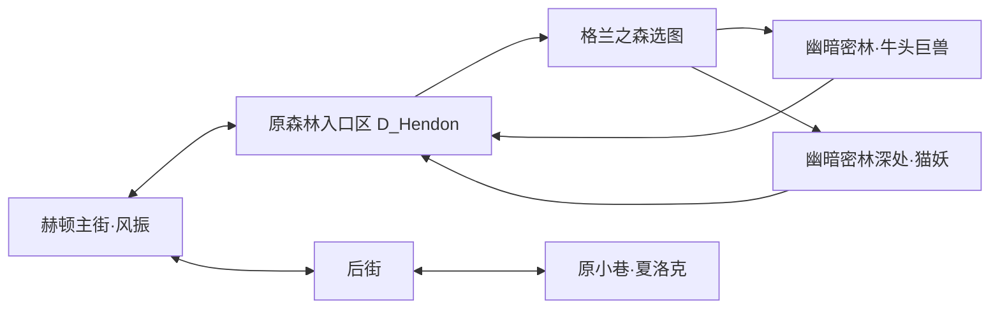

# 格兰之森首段与原副本编排

入口：[31任务契约](31_任务系统详细设计.md)、[34城镇联通](34_城镇联通与赫顿首批.md)。用户本轮指定只推进任务、副本、城镇；经济/耐久服务由另一会话按文件分工交付。

## 一、本批可玩路线

主街左门源组[1,230,19,195,2,6]对应D_Hendon右门[873,122,22,187,2,0]。入口区左门的原目标为[-1,-1]，其TWN area6标注dungeon gate 2，运行接格兰之森选择，不当作不存在的城镇ID。

后街上门[237,155,87,19,2,3]对应Hendon_Ura下门[462,342,91,20,2,2]。夏洛克原NPC9在Ura的[619,193,0]，不放到既有辛达/G.S.D街段。其它雪山/酒馆/西海岸连接继续不开放。

两条新街区都用源virtual movable area矩形并集。出口沿用边缘自动触发、目标资源预检、候选先保存、淡入淡出、按键松开、安全落点与角色位置恢复；不另造传送菜单。小巷/入口区源TIL与背景、人物原ANI/IMG均随本批小包共享。

## 二、任务白名单

| 源ID / 运行ID | 源等级/前置 | 本批目标与交付 |
|---|---|---|
| 105 / gran.tau_rage | 3 / 104 | 风振接取，幽暗密林击败monster/tau/taubeast.mob一次，回风振交付 |
| 106 / gran.cat_trouble | 4 / 105 | 风振接取，在幽暗密林深处击杀monster/lugaru/lugaru.mob五只，回风振交付 |
| 107 / gran.meet_shylock | 5 / 106 | 风振接取，到小巷与夏洛克真实交谈，再向夏洛克交付 |

原NPC、等级、前置、目标参数、源路径与SHA保存在quests.json。源complete npc index=-1按接取人处理是E-INFER；金币/XP、中文叙述和本地奖品范围仍是E-ADAPT。原reward int data逐项保留，不把未知数值解释成完整原版奖励公式，也不发放尚未接入的原物品。

105接在104后，与1901/501/502职业引荐并行，不额外强迫先完成职业介绍。106只算普通猫妖，暗咒猫妖/其它哥布林不替代目标；事件还必须属于对应地下城。击杀即时保存与重发去重沿用31契约，回城交付才发奖/解锁，失败或撤退不伪造通关。

108/4302凯诺链未启用，后续需雷鸣废墟、原领主及对应机制准备好再开放，不能留下接受后永远无法完成的任务。

## 三、副本与选图契约

- dungeons.json持有region、requires、min_level、monster_level、map_export、rooms和source。最小等级与basis level分别从原DGN读取，不能把角色等级或默认Lv.1当作新图怪物基准等级。
- 洛兰口显示洛兰地区卡片；赫顿入口区显示格兰之森卡片。原granfloris.img的帧0/1用于幽暗密林/深处，未解锁卡片置灰，进入按钮拒绝未满足前置/等级的角色。普通/冒险/王者沿用现有控件，紧贴当前选中卡片。
- 幽暗密林在104交付后开放，深处在105交付后开放；这是本地白名单开图策略，不冒称已恢复原版全部地区开放条件。
- 每条路线的首/末格从原DGN候选对中选取，每一相邻房间使用双方原MAP共同拥有的门向/脚点。保留全部源候选与诊断，实际游玩使用固定路线；未恢复随机迷宫算法。
- CombatSession.start_room预检所有MAP/怪物与双向门，缺依赖直接拒绝启动，不删除无法识别的怪物。运行每个房间的原怪物记录，结算/返回仍由公开事件驱动。
- 新图掉落沿用35现有功能样板表，并加入enabled_dungeons；拾取/治疗/结算走原实例账本与事务。原掉率和精确奖池未恢复。

## 四、画面与怪物依赖

原资源放在独立flow_v1/gran_v1，既有hendon_v1不覆盖。包含D_Hendon、Hendon_Ura、夏洛克原立绘/field ANI、两张原选图卡及两张DGN导出。NativeTown为该包独立缓存loader，只有对应街区可见，继续复用一个玩家演员。

新增牛头巨兽、猫妖、暗咒猫妖及两图所需的原哥布林变体，保留原MOB/ANI/ATK和贴图。编译器只扩源白名单，怪物表只扩内容配置；冰/火投射物接现有公开投射物流程，源PTL的档案根路径按编译器规则处理。

本备份Gero投掷十夫长缺attack info和throw attack。运行显式声明attack_template=goblin_thrower，复用现有石块投射数据，保留Gero原动作/贴图；不把这项适配称作原AI恢复。牛头巨兽冲撞/吼叫、猫妖跳扑/咬住及诅咒完整语义也不在本批内核扩展范围，继续交战斗侧还原。

哥布林堡垒OBJ的basic motion为空、etc motion有组成部件。导出使用原Body、DoorReady、Flag、Grass、FloorGrass在源锚点组合默认状态，保留warning与适配说明；不把空基础动画当缺图后删掉堡垒。堡垒破坏与主动投掷脚本未恢复。

## 五、验证与交付

1. 以已完成艾尔文/赫顿引荐的声明夹具起步，不冒称从建角重跑全部历史章节；从风振开始用真实方向键、E、选图/任务按钮完成本批。
2. 实际通关两张图，牛头巨兽真实死亡才推进105，普通猫妖死亡按区域和身份推进106；沿途真实E拾取和正常药剂治疗，不改HP、不删怪、不伪造胜利。
3. 从原入口区回主街交付，再经后街上门进小巷交107；原大立绘、源坐标、锁图/解锁、反向门、位置与任务读档共同验证。
4. 自动检查源QST字段、原DGN首末格/成对门、所有怪物依赖、原IMG像素和怪物图集裁切；实际渲染核查中文与原图表现，技术通过不替代用户验收。
5. 自包含v13资源包发布后，以无完整库的新目录只拉Git和小包，经正式入口复跑。原怪物特殊AI/源版本认证等缺口在交付记录中保留。

运行与证据见[本批记录](../reports/ws2/2026-10/2026-10-23_格兰之森首段原副本与夏洛克.md)，当前计数见[看板](../project/01_进度看板.md)。
