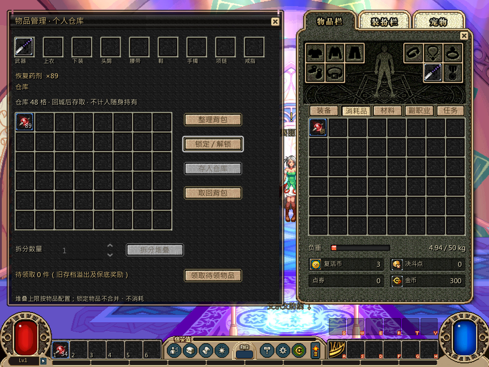

# 仓库与装备操作界面

本轮按[并行计划](../../../tasks/design_tasks/dnf_restore_parallel_v1.md#ws1-独立开发)完成仓库与装备操作窗口。共存取、拆分、锁定、整理和待领取事务沿用现有 `Inventory` 入口，本批集中补齐管理板的局部刷新、禁用状态、失败回执和焦点恢复。

## 交付

- 个人仓库管理板改为稳定根控件。选择、拆分、锁定、存入、取回、整理和待领取成功后只刷新管理内容与右侧共用背包，不再清空整个 modal。
- 管理动作会按所选位置启用或禁用：拆分只接受背包内可变数量堆叠，存入只接受背包物品，取回只接受仓库物品，穿戴槽不提供锁定/拆分。
- 拆分使用真实数量上限并保留原 UID；拆分出的新栈可独立入库。整栈存入、取回继续沿用已发布契约，不新增部分仓库接口。
- 锁定物品存取会在窗口内显示拒绝原因。满仓、满包和保存失败都保留原所有权、位置与金币，不再依赖任务/背包窗外不可见的 toast。
- 本地刷新后把焦点还给刚执行的按钮，保证连续键鼠操作不会跳回窗口顶部。待领取区仍显示剩余件数，空间不足时保留未领取记录。
- 右侧背包由共用窗口生成；ws1 只在管理板事务完成后刷新该共用视图，未修改背包格、拖放或分类页签实现。

## 验证

| 入口 | 结果 |
|---|---|
| `-Test -ItemsOnly` 既有物品/存仓/掉落流程 | **31项 failures=0** |
| `test_ws1_item_ui_inventory_contract.gd`，headless | **38项 failures=0** |
| 同一契约，私有桌面实绘 | **42项 failures=0** |
| 正式完整循环 `--loop-test` | **470项 failures=0** |

新契约覆盖空仓、拆分后入库、整栈取回、锁定拒绝、满仓、满包、整理、保存失败重试、局部根保持、焦点恢复、磁盘重载和 1×/2× 像素输出。仓库规则文件、共用背包格和拖放接口未改。

依赖门禁仍只有两条既有 ws2 生产文件违规：`combat/api/combat_session.gd -> loot/native_box.gd` 与 `combat/resolve/native_breakable.gd -> loot/native_box.gd`。

## 实绘

## 边界

当前仓库契约仍是整栈存取；部分入库需先使用背包拆分，再存拆分后的整栈。共用分类页签仍由 ws2 窗口实现和维护，本批只验证与它的组合显示。

自动化与隐藏桌面帧缓冲不替代实际操作。拆分数量输入、锁定反馈、满仓/满包提示、焦点返回和右侧背包切页仍需 rainmk 在正式入口确认。
