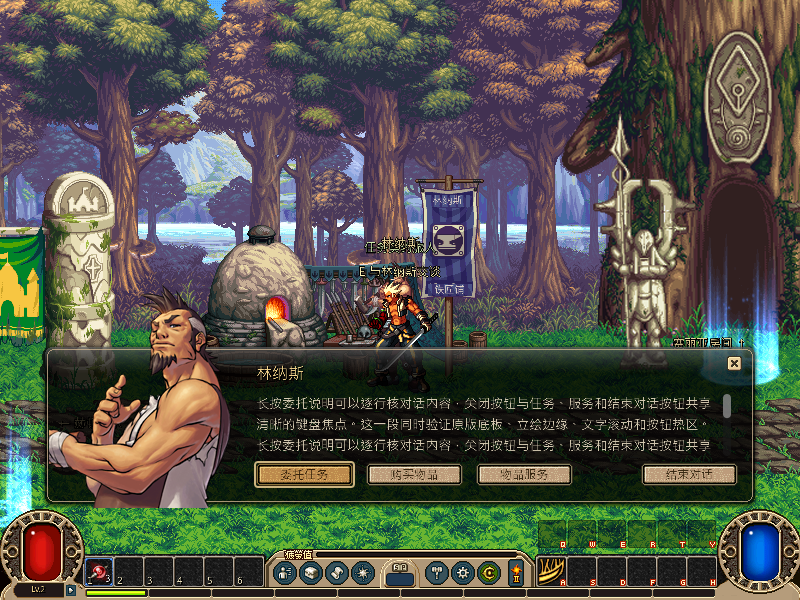
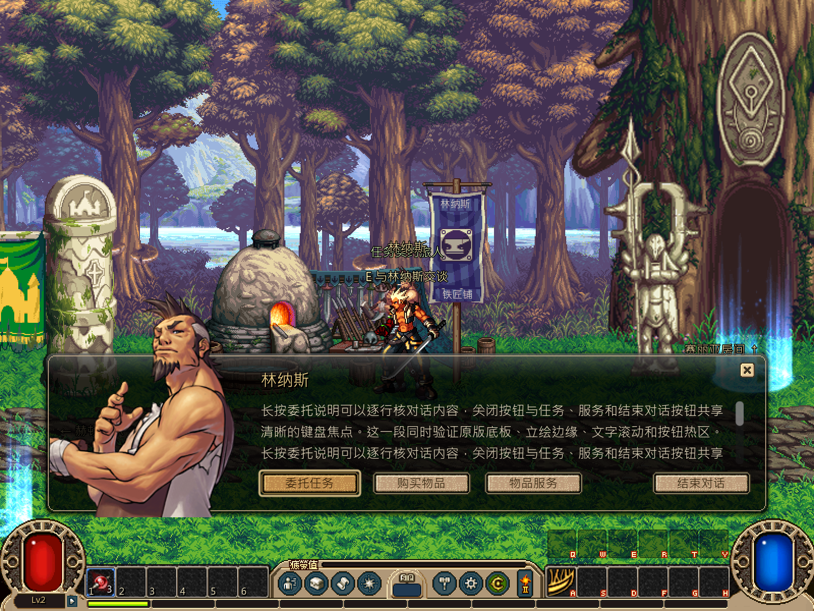
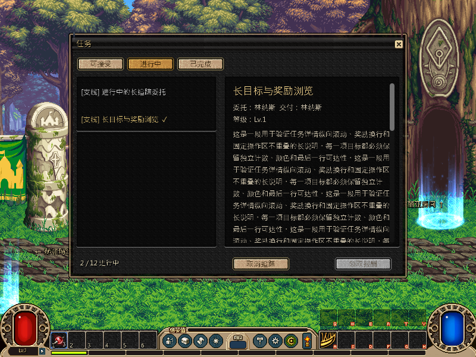
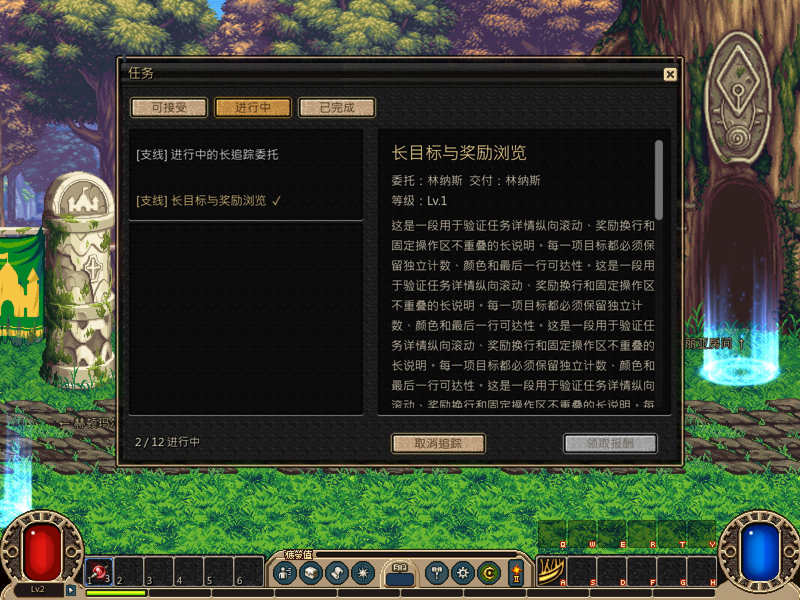

# 任务日志、追踪与 NPC 对话

本轮按[并行计划](../../../tasks/design_tasks/dnf_restore_parallel_v1.md#ws1-独立开发)完成 ws1 首个剩余 P0 模块。只改任务窗口、NPC 对话和右侧追踪，接取、交付、任务规则、保存事务与正式流程继续调用 ws2 既有入口。

## 交付

- 任务窗改为稳定根控件与内容区局部刷新。tab 切换、任务选择和奖励选项不再调用整窗 `show_overlay("quest")`；列表只在任务集合变化时重建，详情滚动节点和当前选择保留。
- 长目标、长说明和奖励物品进入真实滚动区；固定奖励使用原生物品格换行排列。操作区与详情区分隔，末行仍可达。
- 奖励选择支持切换和显式取消。有选奖且未选择时领取按钮禁用；选中后才允许提交，失败时原状态和金币不变。
- 任务窗内新增失败回执。NPC 距离、保存或事务拒绝不再只写一个在任务窗中不可见的 toast，而是在操作区上方直接显示失败原因。
- NPC 对话正文改为真实滚动区，长对白末行可达。委托、商店、服务、结束对话等按钮建立左右/上下焦点链，打开时默认聚焦“委托任务”，焦点移动有原生色调反馈。
- 右侧追踪按签名只在数据变化时更新，并复用标题/目标行控件。任务窗进入或退出时由 modal 子节点信号主动刷新，不再等下一次 0.2 秒轮询。

## 验证

| 入口 | 结果 |
|---|---|
| `test_ws1_quest_window_contract.gd`，headless | **66项 failures=0** |
| 同一契约，私有桌面实绘 | **75项 failures=0** |
| `--quest-guide-only` | **29项 failures=0** |
| `--quest-rules-only` | **50项 failures=0** |
| 正式完整循环 `--loop-test` | **461项 failures=0** |
| 局部任务切换耗时 | headless 中位数 **6.9 ms**；隐藏桌面实绘 **16.7 ms** |

契约覆盖空列表、可接/进行中/可交/完成、真实接取与交付、错误 NPC 失败回执、长目标与奖励滚动、选奖/取消、列表与详情滚动保留、追踪行复用、焦点链和 1×/2× 像素输出。

依赖门禁仍有两条既有 ws2 生产文件违规，本轮未修改：`combat/api/combat_session.gd -> loot/native_box.gd` 与 `combat/resolve/native_breakable.gd -> loot/native_box.gd`。

## 实绘

## 边界

以上是自动化与隐藏桌面帧缓冲证据，不是用户操作验收。键盘焦点移动手感、滚轮/拖动滚动、长奖励列表的可读性和按钮焦点是否足够醒目，仍需 rainmk 在正式入口实际操作确认。

本轮没有修改任务定义、规则、事务、存档、NPC 访问回调、副本选择器、共用背包格或拖放。
