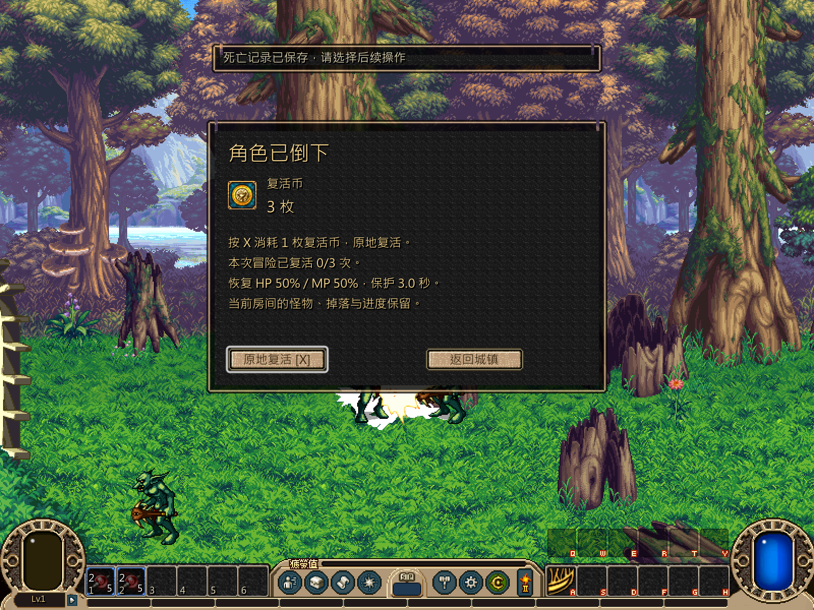
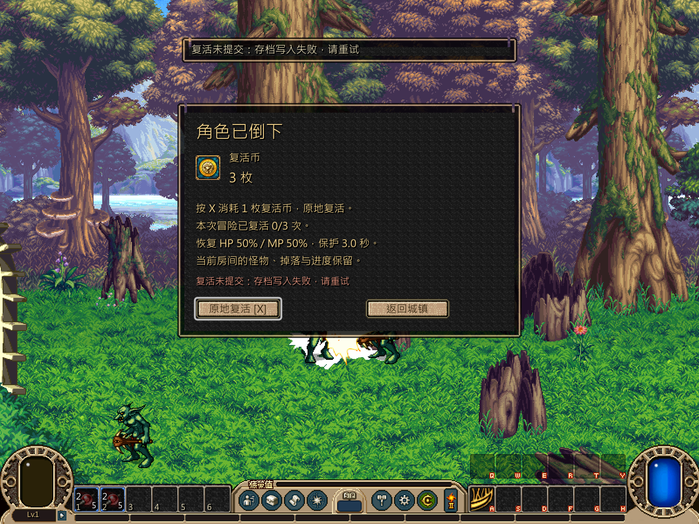
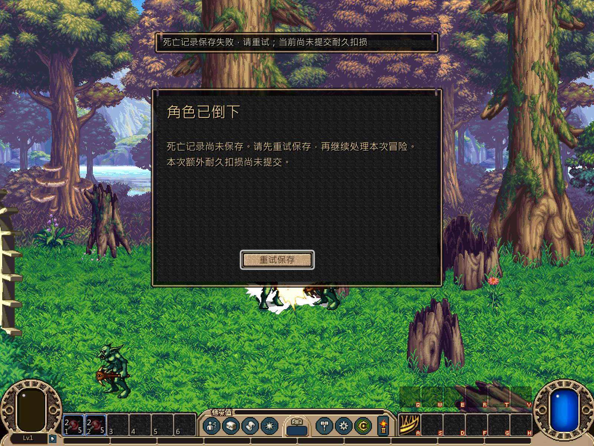

# 死亡复活规则与窗口重试

本轮按[并行计划](../../../tasks/design_tasks/dnf_restore_parallel_v1.md#ws1-独立开发)收口死亡与复活模块。复活配置、战斗恢复和正式路由继续沿用已发布契约；本批集中补齐窗口焦点、X 键失败反馈、保存/效果重试和边界回归。

## 交付

- 死亡窗补显式控件名、窗口内错误回执和键盘焦点链。可复活时默认聚焦“原地复活”，复活币不足或次数耗尽时自动转向可用的“返回城镇”。
- `revive_now()` 统一处理 X 和按钮：没有待处理死亡、复活币不足、战斗房间已变化、报价失效或存档失败都在窗口内显示原因，不再只依赖顶部 toast。
- 保存失败保持 `defeated`、复活币和死亡事务不变，恢复存档后重试只扣一次。战斗端应用失败继续使用 `pending_effect`，按 X/重试按钮只重放效果，不重复扣币。
- 纯规则补跨房报价失效、刷新报价后正常提交、跨死亡复用事务 ID 拒绝；旧档恢复、次数上限和重复死亡账本继续通过既有专项。
- 正式 `-RecoveryOnly` 入口先真实触发原版敌人致死，再分别注入死亡记录保存失败和复活保存失败，验证窗口焦点、提示、同房复活与返回城镇。

## 验证

| 入口 | 结果 |
|---|---|
| `test_recovery.gd` | **57项 failures=0** |
| `test_ws1_recovery_window_contract.gd`，headless | **27项 failures=0** |
| 同一窗口契约，私有桌面 1×/2× 实绘 | **31项 failures=0** |
| `loop.tscn --loop-test --recovery-only` | **48项 failures=0** |
| 同一正式入口，私有桌面实机采图 | **48项 failures=0，6张画面** |
| Godot 4.7.2 editor import | 通过 |

覆盖同房复活、回城、次数限制、跨房报价、过期签名、重复/重放事务、保存失败、效果失败、焦点、X、按钮和正式死亡入口。正式流程不使用直接改 HP 或伪造死亡事件来完成玩家复活段。

## 实绘

窗口契约另有 [1×](../../../screenshots/ws1/2026-11-09_recovery/recovery_window_1x.png) / [2×](../../../screenshots/ws1/2026-11-09_recovery/recovery_window_2x.png) 实绘。

## 边界

窗口焦点和失败分支使用隔离假战斗验证；真实扣币、同房复活和正式入口由 `-RecoveryOnly` 的原版敌人致死流程独立验证。自动化不能替代复活手感、特效醒目程度和复活币经济观感验收。初始复活币余额和每次冒险上限仍是既有 E-ADAPT 参数。
