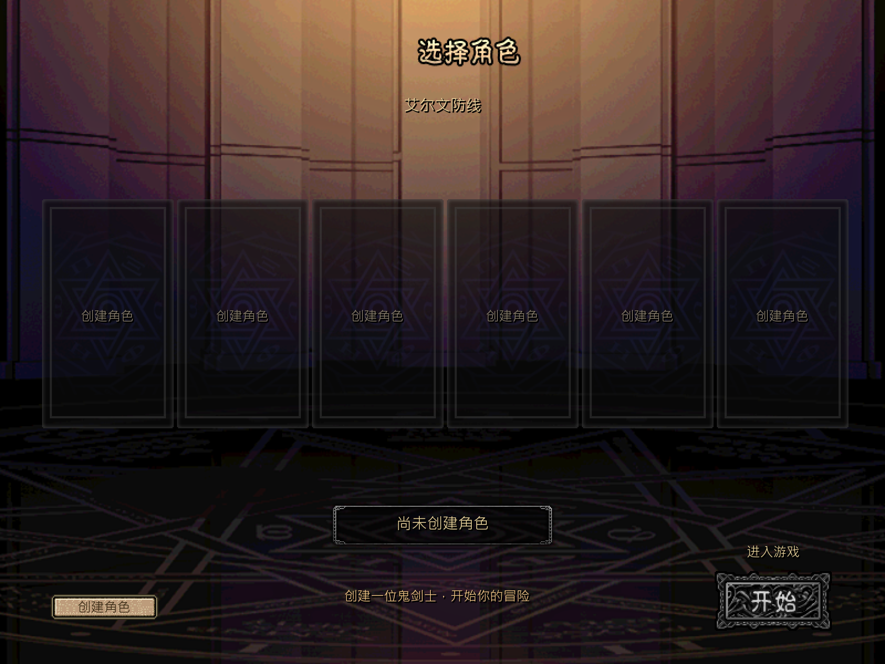
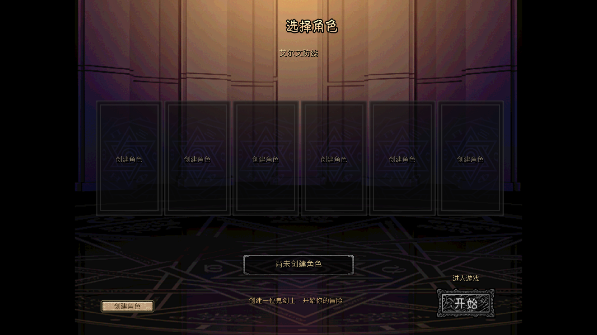

# 窗口与全屏显示适配

本轮按[并行计划](../../../tasks/design_tasks/dnf_restore_parallel_v1.md#ws1-独立开发)完成最后一项显示适配。保持 800×600 逻辑画布、1600×1200 默认输出和既有 F11 路由，只修窗口尺寸、位置恢复与黑边映射。

## 交付

- 桌面能容纳 1600×1200 时保持原固定窗口；可用工作区更小时，窗口按 4:3 等比缩到工作区内，逻辑画布与 `content_scale_size` 仍是 1600×1200。
- 窗口位置计算保留副屏原点和负坐标，不再把负坐标错误钳到 0。部分越界会夹回当前工作区；原屏断开导致保存位置完全不可见时，重开到当前屏幕中央。
- 全屏状态改为显式记录，反复 F11 不再依赖窗口后端是否立即回写 `mode`。退出全屏时重新读取当前工作区尺寸，并恢复最小/最大尺寸约束。
- 新增纯几何 `fit_window_size / centered_position / restored_position / letterbox_rect / window_to_native / native_to_window`，窗口与鼠标换算使用同一矩形，黑边点击不会落到内容控件。
- 16:9 全屏下 4:3 内容居中，左右黑边各 240 px。窗口物理缩放不改变 `CONTENT_SCALE=2`、纹理最近邻和 2× 字体 oversampling。

## 环境与验证

隔离 Windows 私有桌面实测：Standalone、非嵌入编辑器、2 个显示器、当前屏可用区 `2560×1392`，未操作使用者桌面。真实 `Window.MODE_FULLSCREEN` 切换、1600×1200 窗口和缩放后指针命中通过。

| 入口 | 结果 |
|---|---|
| `test_ws1_display_contract.gd`，headless | **29项 failures=0** |
| 同一契约，Windows 私有桌面 | **39项 failures=0** |
| 正式完整循环 `--loop-test` | **477项 failures=0** |
| Godot 4.7.2 editor import | 通过 |

headless 与覆盖参数夹具覆盖小于输出尺寸的工作区、负坐标副屏、部分越界、原屏断开、重复全屏和嵌入模式所有权判断。Windows 私有桌面覆盖真实 F11 模式、1600×1200 帧缓冲、1920×1080 内容布局、黑边坐标和缩放后鼠标命中。

## 实绘

1920×1080 图为实际游戏 framebuffer 按同一 `letterbox_rect` 合成的布局证据；真实窗口尺寸、黑边鼠标拦截和内容点击由同次私有桌面契约单独验证，不把它写成操作系统截屏。

## 清晰度与边界

1600×1200 默认输出保持原 2× 整数采样，文字边缘清晰。1920×1080 下 1200 高内容需缩到 1080，实际约为 0.9 倍最终缩放；文字仍可读，但会略软于默认输出。为保持完整 4:3 画面和固定输出，本批没有用裁切或非等比拉伸换取锐度。

负坐标副屏和原屏断开使用 Windows 键盘映射与矩形夹具验证，没有实际拔插显示器。嵌入编辑器分支只验证所有权判断，未启动可见编辑器窗口。真实多显示器拔插和不同 DPI 缩放仍需在目标机器补一次人工复核。
