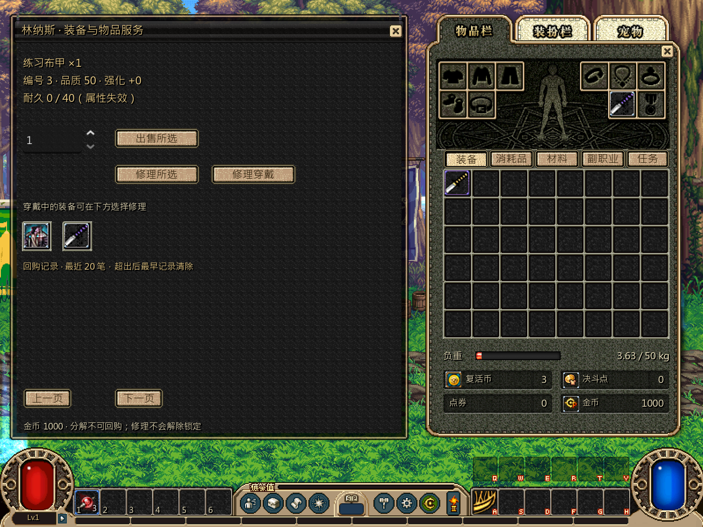
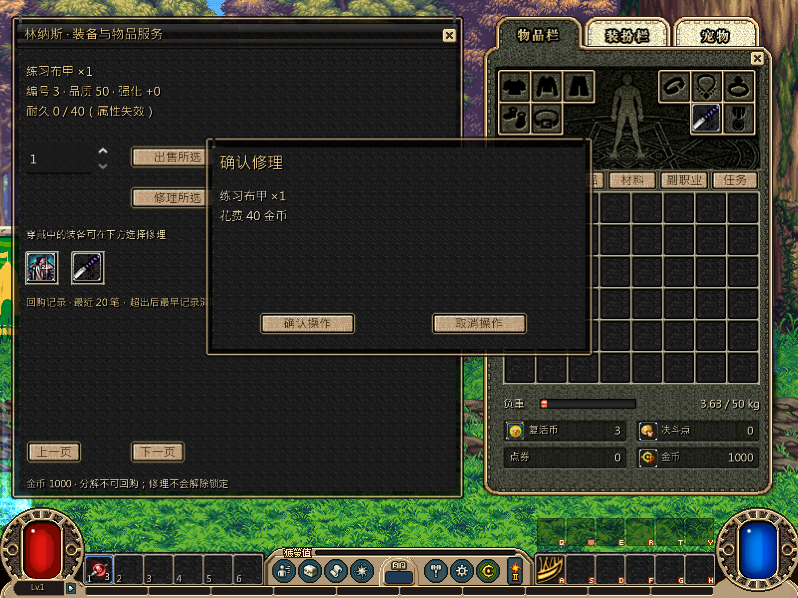
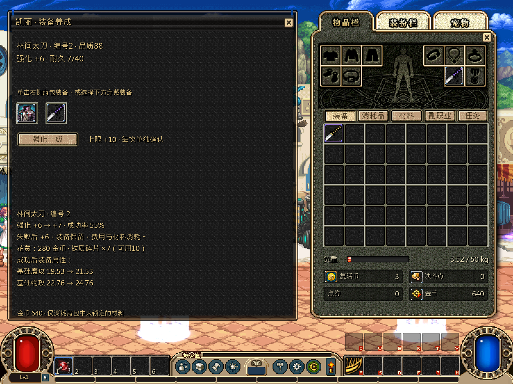
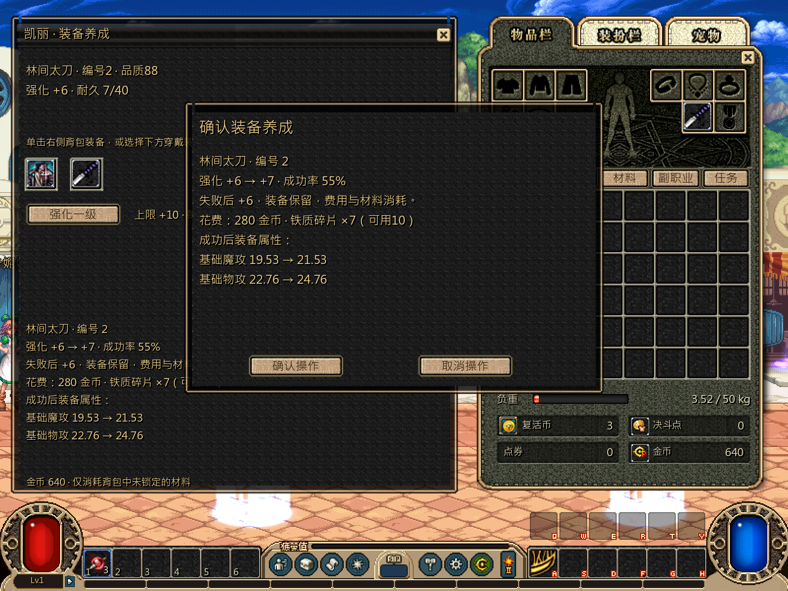

# 装备 NPC 服务全链路

本轮按[并行计划](../../../tasks/design_tasks/dnf_restore_parallel_v1.md#ws1-独立开发)完成装备 NPC 服务窗口。规则、报价、事务与存档字段沿用既有实现；本批集中补齐报价过期后的重新确认、窗口内失败回执、局部刷新和重复提交保护。

## 交付

- 物品服务与装备养成窗口改为稳定根控件和内容区局部刷新。选择、翻页、配方切换和成功提交不再重建整个 modal；右侧共用背包按需单独换新。
- 报价指纹与账本状态在确认时再次核对。价格、耐久、堆叠、金币、材料、目标实例或强化随机状态变化后，旧确认立即关闭并显示“请重新确认”，不会提交。
- 保存失败保留原确认与原报价，显示窗口内重试回执；恢复可写路径后同一确认可重试一次成功。取消、成功和拒绝状态均保留正确焦点与账本。
- 确认按钮在请求期间禁用并加重复提交门。程序化连续触发两次也只消耗一组金币/材料、只推进一次强化尝试或只产生一笔回购。
- 出售数量支持实际部分堆叠；回购恢复同一实例和原品质、强化、附魔及耐久。损坏装备、金币不足、材料不足、锁定/仓库/回购目标等拒绝均在窗口内显示。
- 强化、附魔替换与清除继续使用原报价、候选写盘和随机序列；成功后只刷新养成窗口、详情与共用背包，不改变调用签名或配置格式。

## 验证

| 入口 | 结果 |
|---|---|
| `test_services.gd` | **33项 failures=0** |
| `test_upgrades.gd` | **46项 failures=0** |
| `-Test -ServicesOnly` | **26项 failures=0** |
| `-Test -UpgradesOnly` | **41项 failures=0** |
| `test_ws1_item_ui_service_contract.gd`，headless | **81项 failures=0** |
| 同一契约，私有桌面实绘 | **97项 failures=0** |
| 正式完整循环 `--loop-test` | **461项 failures=0** |

新契约覆盖稳定窗口根、同名实例选择、部分堆叠、报价过期、保存失败重试、金币/材料不足、双击只提交一次、强化随机状态变化、附魔选择/替换/清除、局部刷新与 1×/2× 像素输出。

依赖门禁仍只有两条既有 ws2 生产文件违规，本轮未修改：`combat/api/combat_session.gd -> loot/native_box.gd` 与 `combat/resolve/native_breakable.gd -> loot/native_box.gd`。

## 实绘

## 边界

自动化与隐藏桌面帧缓冲不替代用户实际操作。出售数量输入、滚轮/翻页、确认焦点、失败重试的手感、强化/附魔的正反馈，以及当前 E-ADAPT 经济参数是否合适，仍需 rainmk 在正式入口确认。

本轮没有修改报价和事务字段、NPC 权限、背包格/拖放、属性计算、战斗耐久桥接或配置数值。
