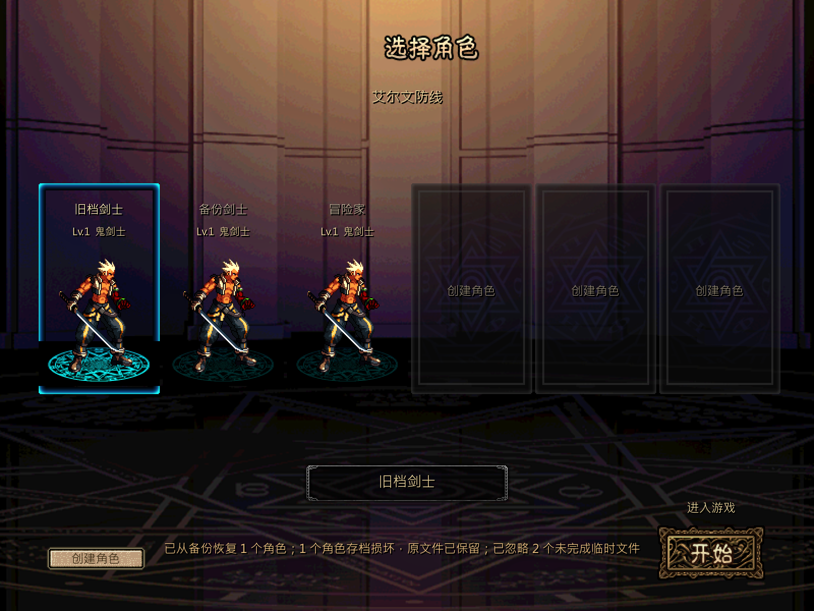

# 角色存档提交与备份恢复

本轮按最新[并行计划](../../../tasks/design_tasks/dnf_restore_parallel_v1.md#ws1-独立开发)接管角色存档文件与档位模块。角色字段、版本迁移、任务/战斗提交时机和正式入口路由仍由 ws2 维护；本批只改文件提交、备份、扫描和选人/建角反馈。

## 交付

- 主档先写 `.tmp`，校验可解析后再提交。成功替换前只从当前有效主档更新一份 `.bak`，损坏主档不会覆盖最后可用备份。
- Store 记录已确认主档的内容签名。文件被外部破坏后，即使复用同一 Store 实例也会重新校验，不会把损坏内容当成有效备份来源。
- 从备份恢复后再次保存会只替换损坏主档，保留原备份；下一次正常保存再推进备份代际。写入失败、目录被文件和临时文件残留均返回明确原因。
- `Characters.refresh()` 隔离单档故障：有效角色继续显示，双损坏档位单独统计，`.tmp`/`.bak.tmp` 不进入选人列表。恢复、损坏和临时文件状态合并为选人窗底部提示。
- 选人窗为从备份恢复的角色增加 tooltip 标识；建角写入失败时保留表单、名称和当前角色列表，并在表单内显示可重试原因。
- 旧单档与多角色档可并存，扫描顺序、同名拒绝和六档上限沿用现有选择/建角入口。

## 验证

| 入口 | 结果 |
|---|---|
| `test_ws1_save_contract.gd`，headless | **52项 failures=0** |
| 同一契约，私有桌面 1×/2× 实绘 | **56项 failures=0** |
| `loop.tscn --loop-test --characters-only` | **64项 failures=0** |
| `test_ws1_character_screen_contract.gd` | **35项 failures=0**；满档首绘中位数 **130.7 ms** |
| 正式完整循环 `--loop-test` | **471项 failures=0** |
| Godot 4.7.2 editor import | 通过 |

新契约覆盖主档往返、有效备份代际、外部损坏检测、备份恢复后再次保存、主备双损坏保留原字节、写入失败、临时文件清理、单档故障隔离、旧档与多档并存、同名、满档、正式建角失败反馈和正式恢复档进入。

## 实绘

## 边界

“写入中断”由真实残留临时文件、损坏主档和损坏备份夹具覆盖，没有在操作系统中实际断电或杀进程。自动化证明 Windows 当前文件系统下的提交、恢复与失败隔离，不替代真实磁盘耗尽、权限变化和断电恢复验收。

本批不负责角色字段校验、存档版本迁移、任务奖励和战斗提交时机，也不新增角色删除接口。选人恢复提示和建角失败文案的实际视觉观感仍需 rainmk 在正式入口确认。
