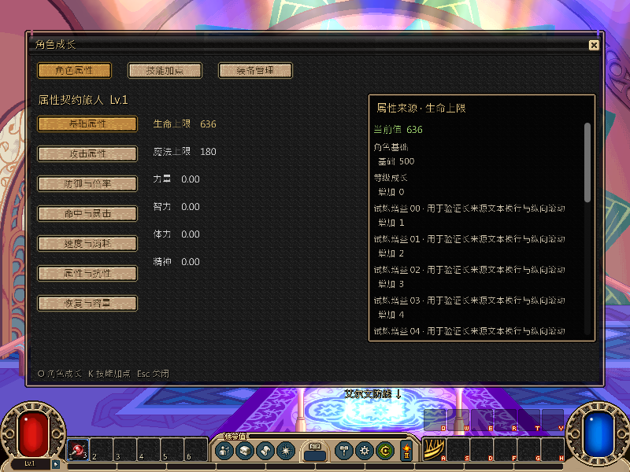
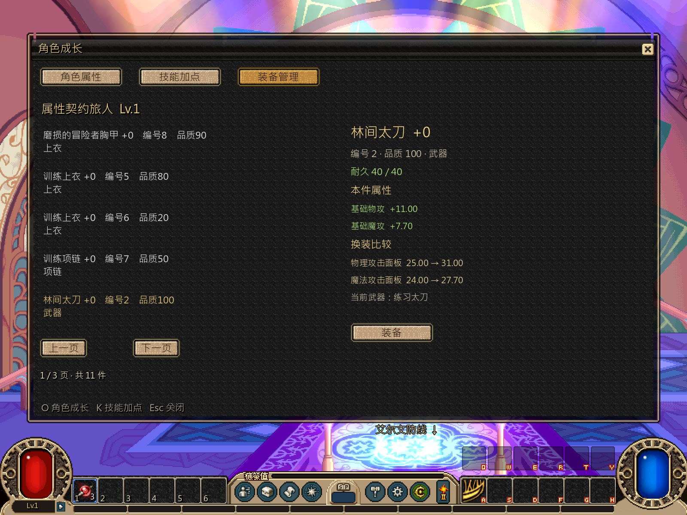

# 角色属性与装备管理

本轮按[并行计划](../../../tasks/design_tasks/dnf_restore_parallel_v1.md#ws1-独立开发)完成角色成长窗口。属性、装备和战斗读值继续使用已发布的 `Numbers`、`Session`、`CombatSession` 接口，换装继续走现有存档事务。

## 交付

- `number_window` 改为稳定根控件。属性分类、属性选择和装备页切换只重建内容，不重复创建 modal 外壳。
- 属性页补 7 类分组、独立单位格式和可滚动来源明细。百分比、倍率、每秒恢复、重量、资源上限分别显示；长来源文本可滚到末行。
- 装备页改为具体实例列表，显示名称、编号、品质、强化和已装备状态。每页 5 件，同名装备按 UID 区分，翻页后保留选择。
- 同槽换装展示当前面板与候选实例的变化。失败在窗口内显示原因并保留原槽；成功后立即切换为卸下动作，再操作可恢复空槽。
- 城镇读取正式 profile 数值；战斗读取当前 combat view，并在来源面板列出未过期临时效果。
- O 键打开角色属性，K 键继续直达既有技能页。共用技能树、快捷栏、属性公式、装备配置和存档事务未改。

## 验证

| 入口 | 结果 |
|---|---|
| `test_ws1_number_window_contract.gd`，headless | **69项 failures=0** |
| 同一契约，私有桌面 1×/2× 实绘 | **77项 failures=0** |
| `loop.tscn --loop-test --numbers-only` | **445项 failures=0** |
| Godot 4.7.2 editor import | 通过 |

新契约覆盖稳定根、分组和属性选择、单位格式、长来源滚动、同名实例、跨页选择、空槽、换装比较、低等级拒绝、成功装备/卸下、O/K 入口、城镇/战斗读值、临时效果和像素输出。长来源使用一次性测试 profile 的替身增益，不进入正式存档或数值配置。

## 实绘

## 边界

自动化与隐藏桌面帧缓冲只证明结构、读值和渲染输出，不替代实际滚轮、拖动、焦点和按钮手感验收。来源面板中的长文本由隔离测试 profile 注入，正式角色仍只显示当前数值接口实际返回的基础、成长、装备、技能和效果来源。
