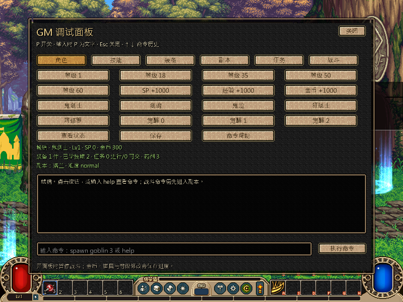
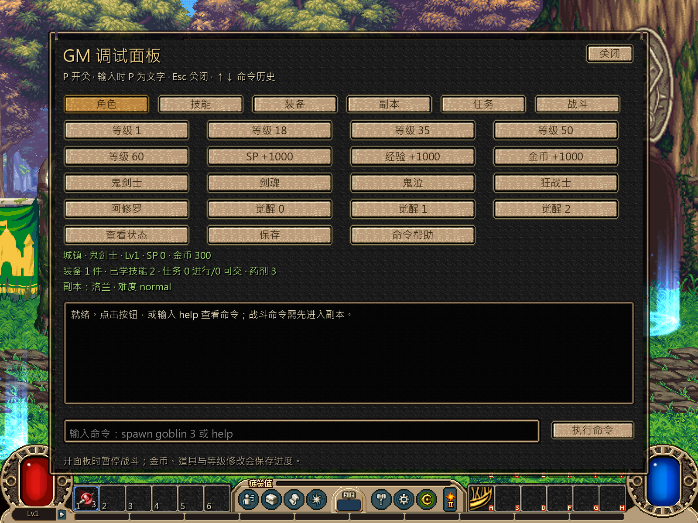

# GM 测试面板扩充

## 结论

GM 面板已从单组战斗快捷按钮扩为六类测试入口：角色、技能、装备、副本、任务、战斗。面板会按当前状态启用或禁用操作，显示职业、等级、SP、金币、装备数、已学技能、任务数、当前副本与难度；输入 `help` 可查看全部命令。

角色、技能、装备和任务修改使用候选 `Session`，通过现有数值、任务与存档接口提交。任务准备、奖励、装备穿脱和技能授予仍经过正式校验，不直接伪造最终状态。所有持久修改成功写盘后才替换当前会话，写盘失败保持原状态。

## 测试入口

| 分类 | 主要快捷操作 |
|---|---|
| 角色 | 等级 1/18/35/50/60、SP、经验、金币、五职业切换、觉醒阶段 0~2、保存 |
| 技能 | 当前职业技能表、已学技能、单技能满级、本职业主动/全部满级、重置 |
| 装备 | 当前等级整套最优装备、单部位最优、图鉴、实例列表、全修复、全损毁、全强化、全卸下 |
| 副本 | 副本列表与可用状态、选择后直入、重开、普通/冒险/专家/王者难度 |
| 任务 | 可接/进行中/可交付/已完成列表、详情、接取、准备目标、批量准备、交付、追踪、放弃 |
| 战斗 | 进入副本、回城、无敌、回血蓝、清冷却、跳房、清房、按本房怪物表刷怪、胜负 |

常用命令：

```text
level 60
job soulbringer
awakening 1
skill list current
skill maxjob all
gear kit 100
dungeon enter lorien
spawn current 3
quest current
quest info lorien.first_clear
quest readyall
```

`spawn current` 读取当前房间 `room_map.monsters` 的 MOB 类型，按实际外观生成测试怪，不固定写死普通哥布林。`quest ready` 会填写目标任务、补足收集/消耗材料并重新计算状态，最终仍由任务规则和任务账本判定是否可交付。

## 验证

| 入口 | 结果 |
|---|---|
| Godot 4.7.2 headless import | 通过，无脚本或引擎错误 |
| [GM 隔离契约](../../../../game_dnf/tests/flow/test_ws1_gm_contract.gd) | **82项 failures=0** |
| 同一契约，Windows 私有桌面 1×/2× 实绘 | **86项 failures=0，2张画面** |
| 正式 `loop.tscn --loop-test` | **480项 failures=0** |

隔离契约覆盖六分类顺序、命令发现、等级、职业、觉醒、技能批量满级与重置、整套装备、耐久/强化/卸下、副本选择与直入、按本房刷怪、任务接取/准备/交付、重载和完整 Session 还原。

## 实绘





状态区为战斗中最多四行预留固定高度，日志框独立下移；1×/2× 实绘未出现状态与日志重叠。

## 边界

- 当前五职业和觉醒阶段以现有运行定义为准；职业成长、自动授予和正式转职任务仍按现有分工继续还原。
- 副本直入仍遵守等级、前置和可用状态，不绕过正式副本配置。
- 任务准备只覆盖当前运行任务系统已有目标类型；原库尚未接入的条件类型不能被 GM 自动视为完成。
- 按本房刷怪面向战斗准备和房间机制测试，仍复用现有怪物模板、AI 和正式房间地图，不等于原版怪物阵容验收。
