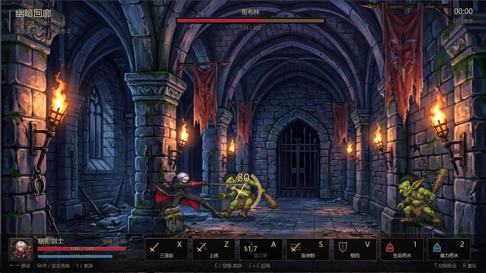
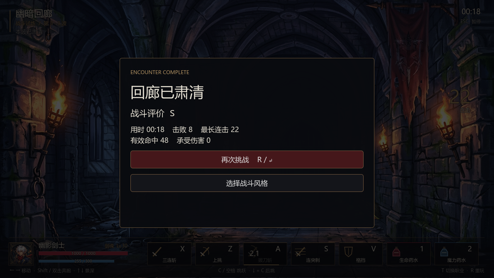

# 2026-10-14 战斗 demo v2：优化与验收

用户目标：先按已确认设计跑通战斗 demo，均衡改善美术、手感与完整战斗体验；实现后推送 Git。范围沿用 M1：基础鬼剑士，狂战士与剑魂各两个代表技能，哥布林一种敌人。新增单屏三波遭遇作为可试玩的战斗闭环，暂不扩展城镇、装备、存档或正式副本奖励。

## 本轮交付

- 职业选择 → 三波遭遇（2 + 3 + 3 敌人）→ 胜负结算 → 重玩 / 重新选择职业。
- 单屏 1280×720，地面基线 576；玩家与敌人都能调整纵深，命中同时检查横向、浮空高度与纵深距离。
- 12 帧输入缓冲，包括命中停帧；三段普攻遵守取消窗口，上挑可接手动起跳与空中普攻。下一刀起手可按方向转身，当前刀活动帧锁定方向。
- 普攻攻速浮点计时，0.7～1.6 倍有效；多段技能每段拥有独立活动窗口、同目标单段去重。收招按最后一段活动结束计算，不再漏尾段。
- 修复血怒霸体、技能霸体、技能蓝耗与冷却。霸体抗硬直但仍受伤；血怒防御降低会增加承伤。拔刀斩仅活动帧无敌。
- 怪物追击、锁定方向的红色挥棒前摇、攻击间隔、实际弹地、倒地与受身无敌；加入连击 / 浮空保护。出血致死正确发死亡事件并计入波次。
- 玩家完整死亡 / 倒地 / 起身；死亡进入失败结算，重玩清除 HP、MP、CD、buff、药水 CD、输入、连段、位移和特效。药水为 demo 无限补给，共享 5 秒冷却。
- 波间 2 秒间隔仍允许玩家移动与收招；Esc 暂停冻结角色、AI、特效与遭遇计时。
- 重做轻量 HUD，仅展示当前可用动作，显示敌人血量、血蓝、真实 CD、连击、剩余敌人、时间与操作提示。
- 11 类原创程序合成音效，8 声道池和群怪命中限频。粒子 / 浮字 / 刀光跟随命中停帧；刀光分刀分组并使用安全三角形绘制，避免跨段退化多边形报错。

## 美术与部署

定稿参照仍为银白红挑染、黑风衣红内衬、红绷带手臂与黑柄长刀的 `art/characters/hero_cool.png`；哥布林仍参照 `goblin.png`，场景沿用既有原创哥特地牢。

使用内置 **imagegen** 生成 `art/sheets/player_demo_v2.png` 与 `monster_demo_v2.png`，共 32 个真实核心姿势。提示词完整保存在 `art/sheets/demo_v2_generation.json`。`tools/bake_demo_art.py` 以连通域保留跨网格的完整武器，统一每角色比例与脚底，输出 25 个动作条、83 帧；不会逐帧缩放导致身体大小跳动。实际动作姿态按战斗前摇 / 活动 / 收招同步，不以帧数猜测动作含义。

| 角色 | 站立身体高度 | 共用画布 | 脚底锚点 |
|---|---|---|---|
| 主角 | 190 px | 296×238 | (128, 221) |
| 哥布林 | 132 px | 239×222 | (114, 201) |

正式 demo 的运行资源提交到 `game/assets/demo/`。新机器拉取后只需 Godot 导入，默认启动不用 Python，不依赖被忽略的 `game/art/`。背景与头像可用 `tools/bake_demo_environment.py` 从正式源图重建。

## 验收证据

Godot 4.7.2 的 headless 与 GL Compatibility 实际渲染均通过 **46 项断言，0 失败**；完整三波通过玩家攻击判定与怪物 AI 物理运行，最后进入胜利，击败 8 个敌人，48 次有效命中。这个自动通关场景给玩家测试无敌，只用于验证流程，普通试玩没有测试无敌。

另将 `assets/data/scenes/scripts/project.godot/icon.svg` 单独复制到全新目录（没有旧 `game/art/` 或 `.godot/` 缓存），首次导入后同样46项通过，确认提交的正式资源可以独立运行。

覆盖：标题控制隔离、音效 PCM 与声道池、25 动作条加载、动画判定姿态同步、提前输入三连、单段去重、实际攻速差、活动后段进入范围命中、纵深隔离、上挑 / 起跳 / 空中追击、多段技能完整命中与伤害、MP / CD / 拒绝释放、霸体承伤、格挡、后跳无敌和位移、药水共享 CD、怪物弹地 / 倒地 / 受身、DOT 死亡、玩家起身、暂停 / 恢复、失败、全量重置、三波胜利与统计、返回职业选择。

美术重烘焙两次内容哈希一致；83 帧无空帧、无裁切，角色内部几何与锚点一致。实机截图验证角色落地、界面、命中姿态和真实结算；抓到并修复了“切状态清空动画名导致停帧显示几何占位”与“按四帧猜姿态导致判定和出刀错相”。





命令：

```powershell
powershell -NoProfile -ExecutionPolicy Bypass -File tools/run_demo.ps1 -Test
powershell -NoProfile -ExecutionPolicy Bypass -File tools/run_demo.ps1 -Capture
powershell -NoProfile -ExecutionPolicy Bypass -File tools/run_demo.ps1 -Test -Capture
```

加速回归静音，但照常校验音频生成；普通试玩与单独截图模式实际播放音效，并验证退出清理。断言测试只在显式 `--test` 下运行；截图只在 `--capture` 下生成。

## 下一轮重点与实际限制

这批资源是有限关键帧 demo，不是完整生产动画库。后跳、血怒、拔刀、怒斩等复用核心姿势；连突刺目前重复伸剑姿势，专用刺击和更多中间帧待补。玩家行走与奔跑共用四帧步态。优先在用户试玩反馈后细化每刀前伸、停顿、浮空时间与场景密度，再补动作帧，避免在手感未定时全量生产。

当前结算 S/A/B 为战斗 demo 的临时评价，尚未接入设计中的正式副本 SSS～F、翻牌或掉落；哥布林队长只是数值 / 节奏变体，不是独立 BOSS。其余转职技能、其他四种异常、局外系统与 BGM 没有在本轮实现。
