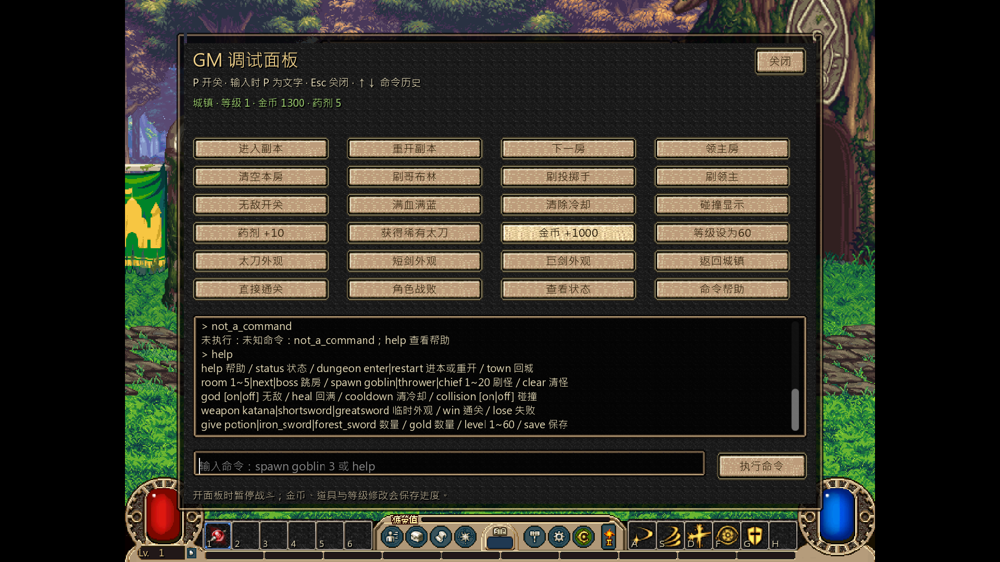
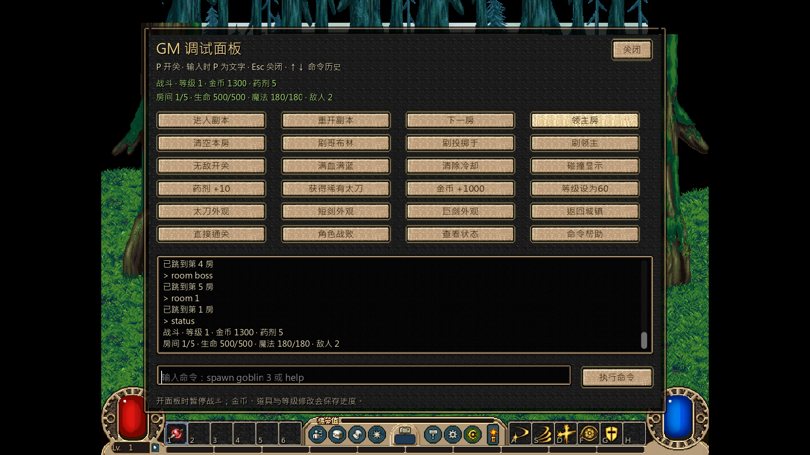

# 固定1080p与GM调试面板

用户要求将循环入口固定1080p，并提供类似旧工程的P键调试面板，可输入命令或点击按钮触发功能。本轮沿用旧面板的功能组织、命令历史和P/输入框焦点规则，视觉复用新版原素材组件，不搬旧版动作实现。

## 显示与入口

- 使用tools/run_dnf_loop.ps1；编辑器打开game_dnf/scenes/loop.tscn按F6。独立main场景及两份已有project.godot本机编辑不改动。
- 固定1920×1080渲染目标和窗口尺寸，禁止拖动改变尺寸；F3只提示当前规格，F11切换窗口/全屏，全屏仍渲染1080p。
- 原版逻辑仍为800×600，场景和UI统一1.8倍变换为1440×1080，居中x240；两侧各240黑边，场景裁切避免地图溢出。角色/物品/战斗坐标不修改。
- 原msjh字体以1.8倍密度重新栅格化。原PNG、ANI、图集、资源锁和共享运行包均不变；这不等于原像素素材增加细节，最近邻非整数缩放仍有像素宽度差异。

## 面板操作与命令

P开关，按住不重复切换；输入框中的p保持文字，Esc关闭并释放焦点。回车或“执行命令”执行，上下键查看历史；最多保留100条历史和40段日志。回车保持编辑模式，连续命令无需额外点击。
面板有24个快捷按钮，包含下表常用功能。开面板暂停战斗、关闭战斗键盘输入；关闭时清除按住/缓冲输入并按原覆盖层状态恢复；原菜单/结算仍保留。所有界面及反馈为中文，命令标识为英文。

| 命令 | 行为与边界 |
|---|---|
| help / status / save | 命令帮助、当前城镇/战斗状态、保存进度 |
| dungeon enter / dungeon restart / town | 进入试炼；先撤退/回城再新开Run；回城并清理战斗场景 |
| room 1~5 / room next / room boss | 战斗中跳房；越界拒绝，保留当前Run与角色状态 |
| spawn goblin/thrower/chief 1~20 | 生成原哥布林/投掷手/领主标记怪；清房后再刷怪会重新锁门；单次最多20只 |
| clear | 清空本房；关闭面板后走真实死亡/开门/领主结算流程 |
| god [on/off] / heal / cooldown | 无敌开关、生命魔法回满、清除实际技能冷却；仅进行中的战斗可用 |
| collision [on/off] | 切换战斗碰撞几何显示 |
| weapon katana/shortsword/greatsword | 当前战斗临时武器外观，不改背包装备或伤害倍率 |
| win / lose | 清领主房或触发角色战败，使用正常结算/奖励去重；不伪造第二笔奖励 |
| give potion/iron_sword/forest_sword 1~999 | 添加现有目录物品并保存；未知物品、负数、小数拒绝 |
| gold 1~999999 / level 1~60 | 增加金币或设等级并保存；等级属性在下一次出征生效 |

命令仅识别明确清单，不执行任意脚本或系统命令。金币/物品/等级会写当前游玩存档，面板底部有说明；测试使用独立temp存档，不修改用户实际存档。

## 实现与验证快照

- display_settings负责输出和缩放，debug_panel负责原组件布局/输入/历史，debug/loop_commands负责校验和流程操作，debug/runtime_api继承既有test_api，将战斗内部调试访问隔离在debug模块。ws1的main、内核和公开combat/api实现均未改。
- Godot4.7.2真实渲染188项通过、0失败、24张实机图；含固定1080p/黑边/鼠标坐标、原完整五房通关、P实际可见/重复按键/输入p/连续回车/历史/按钮、暂停与按键隔离、错误命令不改状态、刷怪/跳房/碰撞/回血/清CD、胜负/奖励幂等、GM存档回读及F11保持1080p。
- 正式启动器无窗口模式178项通过；headless不提供窗口管理标志，禁缩放和F11窗口检查由上述原生窗口实测覆盖。
- 中文扫描、模块依赖检查通过。旧原OGG注释格式警告保持源字节，本轮不处理音频。
- 临时实机日志temp/gm_loop_final.log；以下两张PNG原字节入Git，供其它工作区复核，无需更新原资源Release。

## 用户实测后的编辑器入口返修

用户截图显示Game预览右上角仍为1280×720。前轮只固定了运行时渲染/独立窗口，工程window_width_override/window_height_override仍为1280/720，编辑器嵌入预览会使用这组启动覆盖。
现将两项覆盖改为1920/1080；保留640×360的独立战斗场景基准，循环运行时仍使用1920×1080渲染目标。用户本机把main_scene改为loop的选择及其它已有配置保留，不把这些本机差异一并提交。
display_settings使用Engine.is_embedded_in_editor判断嵌入模式，避免设置不受支持的不可缩放/位置/全屏；嵌入菜单说明改为由编辑器工具栏控制预览。
已读取编辑器输出中原有的“Embedded window resize can't be disabled / Embedded window can't be moved”记录。Computer Use准备从编辑器运行复核时，被用户物理Esc中止，之后未再操作编辑器；不宣称已看到修复后工具栏尺寸。无窗口流程回归通过，用户需停止旧进程并重载项目设置后重新运行；本轮编辑器实机尺寸待复核。
