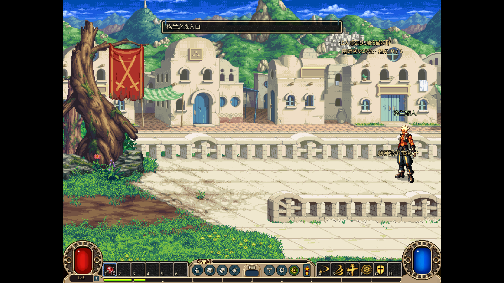
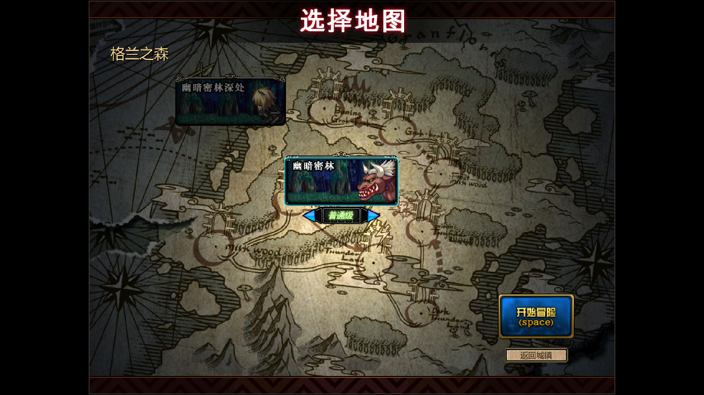
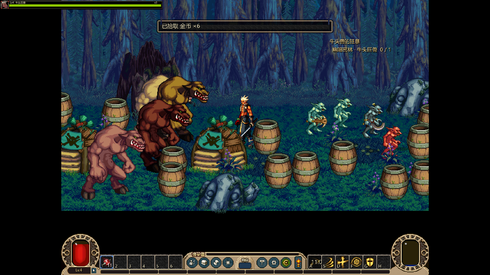
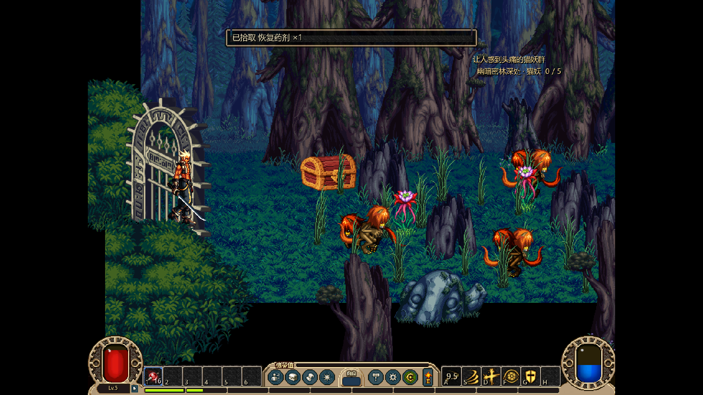
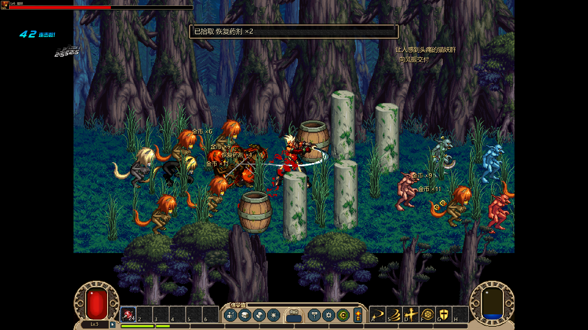
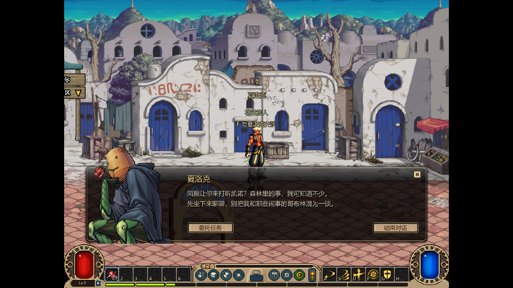

# 格兰之森首段、原副本与夏洛克

用户明确本会话继续任务、副本、城镇。规范入口[36](../../../design/36_格兰之森首段与原副本编排.md)，原图规格/依赖见[资源任务](../../../tasks/art_tasks/dnf_gran_native_v1.md)。同目录服务会话a649bb6a成果保留，不在本批重做交易/耐久功能。

## 已接入

- 主街左口↔原D_Hendon森林入口区，走到左边缘自动进格兰之森选图；后街上口↔原Hendon_Ura小巷，夏洛克按源NPC9脚点619/193入场。
- 原105牛头兽的狂暴、106让人感到头痛的猫妖群、107呼唤闪电的哥布林，按原前置/等级/NPC/目标衔接104。与鬼剑士引荐并行，杀怪目标限定原MOB与地下城，不把暗咒猫妖替代普通猫妖。
- 原幽暗密林/幽暗密林深处分别采用六房固定路线，起点/领主格来自源DGN候选，相邻门按双向MAP记录配对。新增原地图、原牛头巨兽/猫妖/暗咒猫妖与必需哥布林变体、冰火投射物、原选图卡和夏洛克原大立绘。
- 幽暗密林在104交付后开，深处在105交付后开；地区选图分开，锁图置灰、难度紧贴当前卡片。原DGN最小进入等级与怪物basis level分别接配置/公开数值接口，副本回城恢复实际入口区。
- 两图沿用现有真实掉落表与E拾取，正常药剂治疗；任务击杀即时保存、去重、奖励原子交付和每角色位置/小巷存档继续复用现有契约。
- 源堡垒OBJ无基础ANI，改用它列出的原Body/DoorReady/Flag/Grass/FloorGrass部件保留初始画面；保留适配warning，未声称实现堡垒脚本。

## 验证快照

专项从“已完成艾尔文与赫顿引荐”的声明夹具开始，真实移动/E/GUI与两场实际战斗；不伪造死亡、胜利或HP，不把这段测试称作从建角重跑全部章节。

| 验证 | 本轮快照 |
|---|---|
| 最终实际渲染 | 108项通过，23次帧缓冲保存/22个不同1920×1080文件；两场各六房正常通关、两位原领主接近画面、沿途E拾取/药剂、回城与107交付/读档 |
| 原任务目标规则 | 19项通过，牛头兵不替代牛头巨兽、错图不算、暗咒猫妖不替代普通猫妖、部分进度JSON恢复、死亡重发去重与错人物/重复交付拒绝 |
| 城镇纯图/地面 | 70项通过，含新增四个双向门和安全落点 |
| 原图与结构 | 7项通过；新210张PNG与原IMG字节相同，7套新怪物图集与源帧裁切/offset一致；任务字段/原首末格/双向门/全怪物依赖通过 |
| 既有流程回归 | 正式完整循环315、原洛兰首章43、赫顿专项122、独立战斗143项通过，均failures=0 |
| 无完整库的新消费端 | 空目录远端安装基础61文件、v13运行906文件、独立items v2图标4文件；正式入口108项通过，无library_v1和本地构建标记 |

日志为temp/gran_render_final_03.log、gran_rules_02.log、gran_world_unit.log、gran_source_audit.log、gran_full_final.log、gran_lorien_final.log、gran_hendon_final.log、gran_combat_regression.log。依赖0违规、游戏源文字无韩文、原卡片/街景/人物实际画面已核查。权威计数维护在[看板](../../../project/01_进度看板.md)。

消费端工程为temp/gran_consumer，外部新缓存D:/dnf-gran-v13-consumer-cache，使用Git内的工程设置，未带入两份用户未提交设置；下载日志gran_consumer_base/flow/items.log，正式入口日志temp/gran_consumer_official.log。旧v12依赖与同目录服务会话的独立items v2锁均保留，未要求其它区安装完整客户端/完整提取库。

## 原素材实机













## 资源与运行

不可变运行包/实机：[dnf-loop-v13-granfloris-20261023](https://github.com/mkkzzz/dnflike-assets/releases/tag/dnf-loop-v13-granfloris-20261023)。内容锁为game_dnf/flow_store.json，独立items锁继续由服务会话维护。新图/城镇在flow_v1/gran_v1，原怪物/内容依赖仍随combat_runtime交付。

```powershell
git pull --rebase
tools/run_dnf_loop.ps1
# 专项复现（独立临时存档）
tools/run_dnf_loop.ps1 -Test -GranOnly -Capture
```

正常游玩完成104后找风振接105，沿主街左侧走到森林入口区，再走到左边缘进选图。牛头巨兽击败后回风振交付并接106；去深处杀猫妖，再回风振接107，经后街上门进小巷找夏洛克。沿途可E拾取掉落并用药剂恢复。

## 已知适配与边界

- 备份PVF不是已认证生效版本；固定路线替代原随机迷宫，地图图层/坐标语义仍有推断部分。原IMG保持源像素，不宣称重制高清。
- 金币、经验与掉落沿用功能适配，原reward int data原样留档；未接入的原物品奖励不伪造。完整经济/精确原版平衡继续其它批次。
- 原Gero缺攻击定义，显式复用原投掷哥布林的石块攻击数据并保留Gero原动作/贴图；其它新怪物使用现有通用战斗入口。牛头巨兽冲撞/吼叫、猫妖跳扑/咬住、诅咒与堡垒主动/破坏脚本未完整恢复，需战斗侧继续。
- 部分源哥布林装备分层缺文件，导出诊断保留；本轮没有补画伪造来源。108/4302、雷鸣废墟/凯诺及其它地区未开放。

技术通过与人工画面核查不替代用户对原版一致性和手感的验收。
