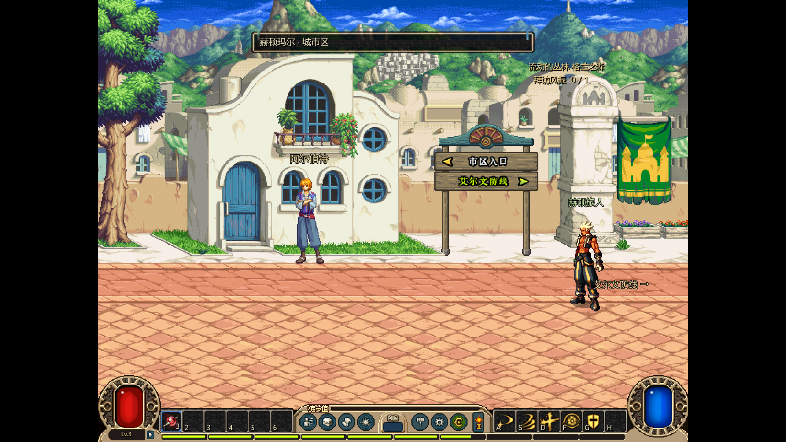
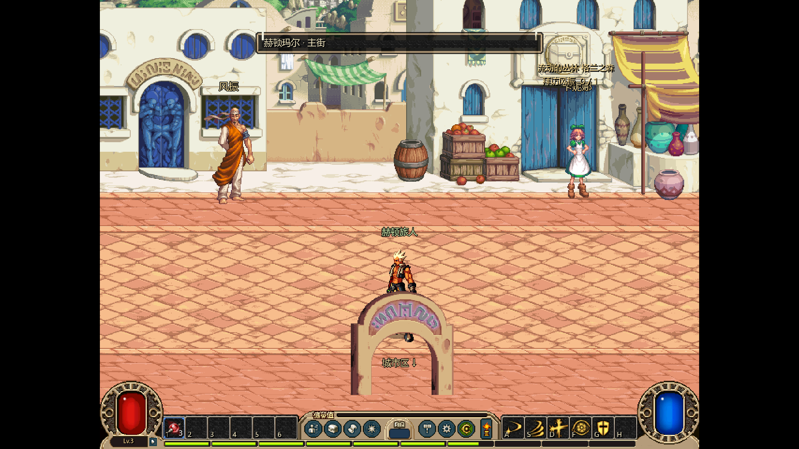
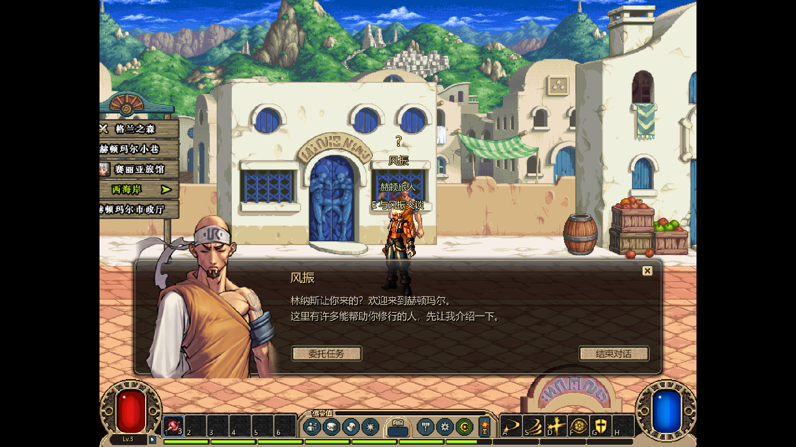
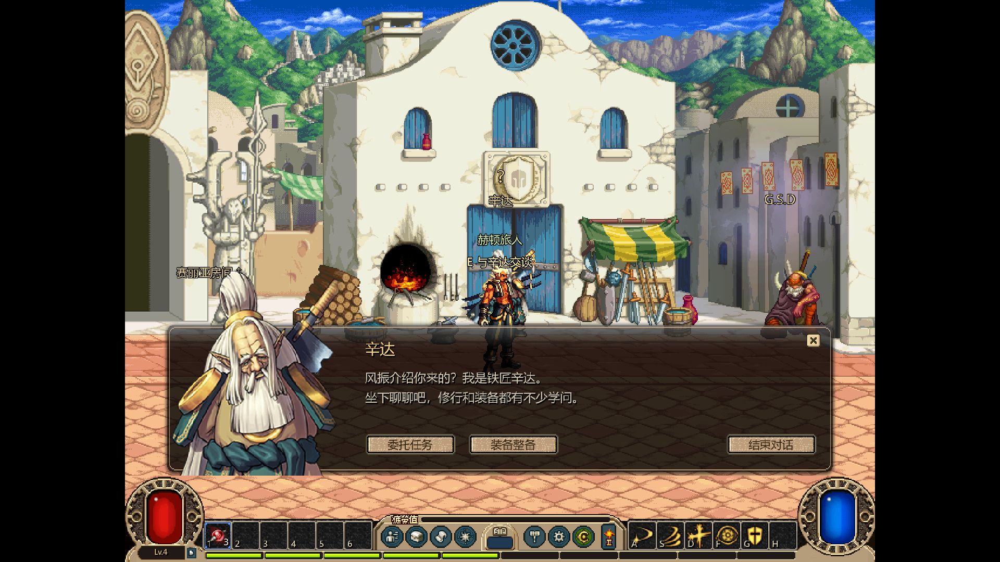
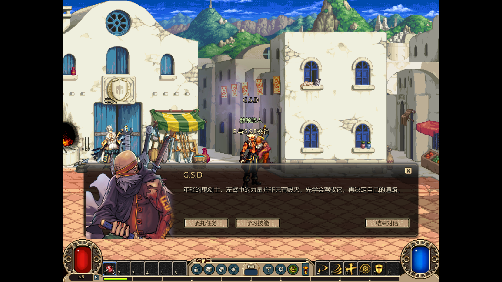

# 赫顿街区任务与城镇联通

用户要求继续下一个城镇、任务与NPC，特别强调城镇联通和场景切换。沿用原美术/中文路线，本批规范见[34城镇联通](../../../design/34_城镇联通与赫顿首批.md)，任务基础见[31](../../../design/31_任务系统详细设计.md)。

## 已接入

- 艾尔文防线左出口↔赫顿城市区右出口；城市区上出口↔主街下出口；主街上出口↔后街下出口。来源为town.lst和MAP六值出口组的相互引用，原坐标留在towns.json与manifest。
- 新增城市区、主街、后街三张各自原MAP，保留原建筑、地砖、前后景、NPC脚点/帧时钟；主街下方用原224×120扩展地砖铺满，纵向镜头可到达下出口，没有黑块补地。
- 风振、辛达、G.S.D及卡妮娜、凯丽、诺顿、歌兰蒂斯、阿尔伯特入场；对应原大立绘和中文对白。G.S.D打开已有技能页，辛达打开已有装备管理；未实现的服务不摆空按钮。
- 原任务104→1901→501→502加入运行白名单；顺接4301，通过真实会面和任务按钮完成。原等级/人物/前置保留，金币/经验与对白是明确适配配置。
- 切场预检资源、候选角色写盘、短淡出/淡入和输入锁；目标落点避开回程门，按住方向跨场景后需松开再行动，避免冲出/回跳。
- 每角色保存场景与坐标，F5/返回选人/出征记录来路。读档恢复对应街区，副本撤退回出征点；无效坐标/移除场景安全回退。
- 后街与艾尔文各自可进赛丽亚房间，退出按入口归属返回；入口归属也随角色存档。房间复用已有原美术，原Gate_Hendon独立场景变体未单独认证。

## 证据与边界

通用Hendon.map缺失，本批显式选(r)Hendon.map，City/Auction用对应原文件。来源PVF仍是备份而非已认证生效版本；建筑原图不是重画的高清图，1080p沿用既有原像素呈现。NPC位置来自源MAP，运行名称与对白为简体适配。

未开放西海岸、月光酒馆、雪山和新格兰副本；新任务502只介绍转职，不执行职业变化，不提前启用13级的506。未实现NPC的分解、修理、制造、强化经济等服务不会因人物出现便算完成。当前地面以原虚拟可走矩形的并集约束，复杂物件实体碰撞与原版同条件画面仍待复核。

与同目录物品/掉落会话按用户既有授权协调：Session仅各自添加职责字段/函数，loop_root按城镇/物品函数分隔；任务与城镇候选深拷贝保留物品账本。共享文件最终提交节点通过文件分工说明协调，未覆盖其物品代码；两份用户project.godot改动保留。

## 验证快照

Godot 4.7.2，测试独立临时角色；新城镇专项明确从“已完成洛兰四任务”的夹具开始，只验证新增段，不冒称重新打了一遍前四任务。新增段使用真实方向键/E、NPC按钮与读写存档，没有直接传送到新NPC代替联通测试。

| 验证 | 本次结果 |
|---|---|
| 纯城镇图/地面/存档规范 | 40项通过，含每条出口/反向边/安全落点、错场景/远距/战斗拒绝、共有房间返回归属、错误配置与非法旧字段 |
| 新城镇真实移动/GUI/持久化 | 97项通过，含三街区完整往返、四任务、G.S.D技能页、双向淡入淡出、持续按键隔离、资源缺失/写盘失败不切场、读档及副本回城 |
| 新城镇实际渲染 | 同一97项通过，11张1920×1080帧缓冲，复核NPC/大立绘、原街景、出口与下方扩展地面、中文招牌与追踪布局 |
| 原洛兰任务闭环 | 43项通过，接取/真实双副本/交付/保存不受新区域影响 |
| 原图与源结构 | 5项Python检查通过；本批121张新增PNG与原IMG逐字节相同，扩展地砖尺寸/原出口六项组/NPC脚点一致 |
| 合并后的完整游戏循环 | 以物品提交bca58c59为基线，正式入口315项通过，原数值/物品实现保留 |
| 无完整库的新消费端 | 新目录从远端安装base、v12与独立items包，经正式入口97项通过；缓存没有library_v1，工程没有本机构建标记 |

技术/人工画面检查不替代用户对原版一致性和手感的验收。本轮完整循环日志为temp/hendon_full_final.log；消费端为temp/hendon_consumer_official.log，消费工程temp/hendon_consumer使用Git中的工程设置，未带入用户两份未提交设置。其它系统专项以协作会话的最终交付记录和[进度看板](../../../project/01_进度看板.md)为准，不重复把旧工程检查数混成本批统计。

## 原素材实机











## 获取与运行

全部赫顿运行素材、来源和本批实机证据发布至[dnf-loop-v12-hendon-20261023](https://github.com/mkkzzz/dnflike-assets/releases/tag/dnf-loop-v12-hendon-20261023)，精确包哈希以game_dnf/flow_store.json为准，远端digest已逐项核验。新增NPC/地图在flow_v1包，旧洛兰/战斗依赖仍随combat_runtime包；物品图标使用物品会话的独立items_store锁，不混在城镇包里。

```powershell
git pull --rebase
python tools/sync_dnf_flow.py
tools/run_dnf_loop.ps1
```

完成原四任务后去林纳斯接“流动的丛林 格兰之森”；沿艾尔文左侧到路口按E，经城市区上出口前往主街找风振，再由主街上出口进后街找辛达/G.S.D。路口文字、任务列表和追踪均为中文。也可提前自由探索城镇，任务仍校验原前置与等级。

复现：tools/run_dnf_loop.ps1 -Test -TownsOnly；加-Capture保存渲染。完整库制作端-BuildAssets会同时运行tools/build_dnf_hendon_assets.py；消费端只需小包，不需要原版客户端或完整提取库。
