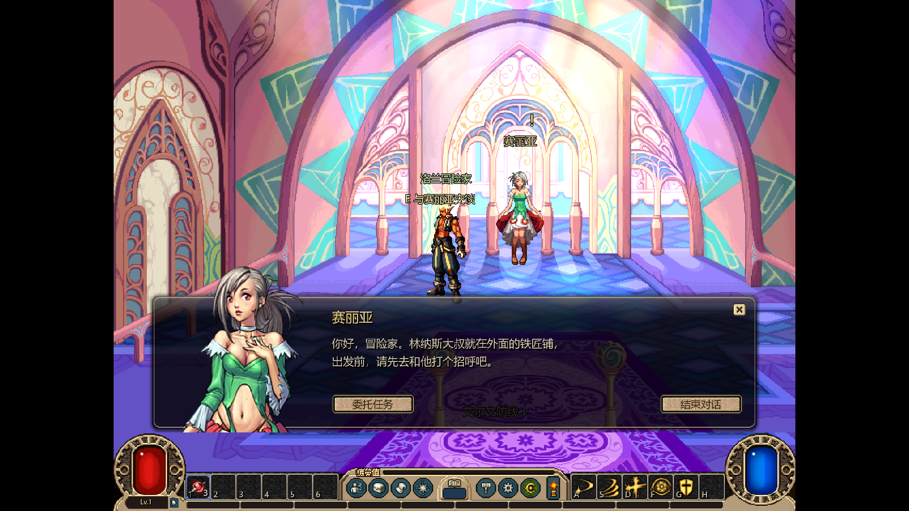
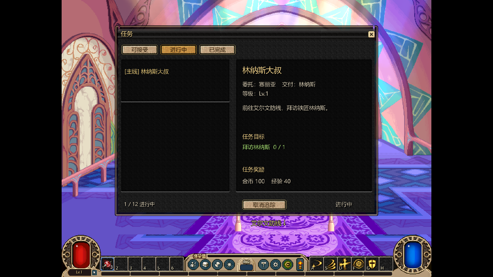
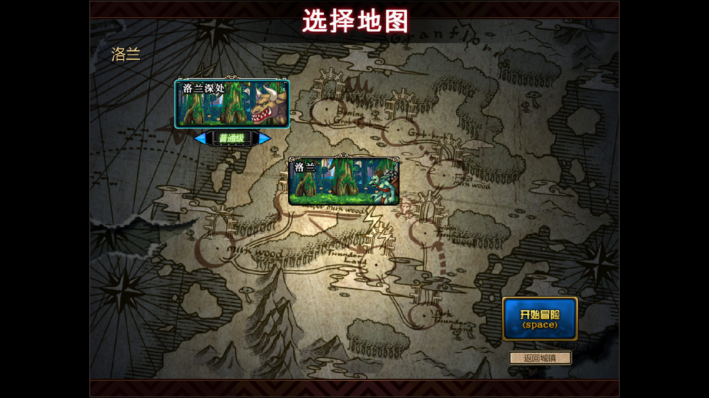
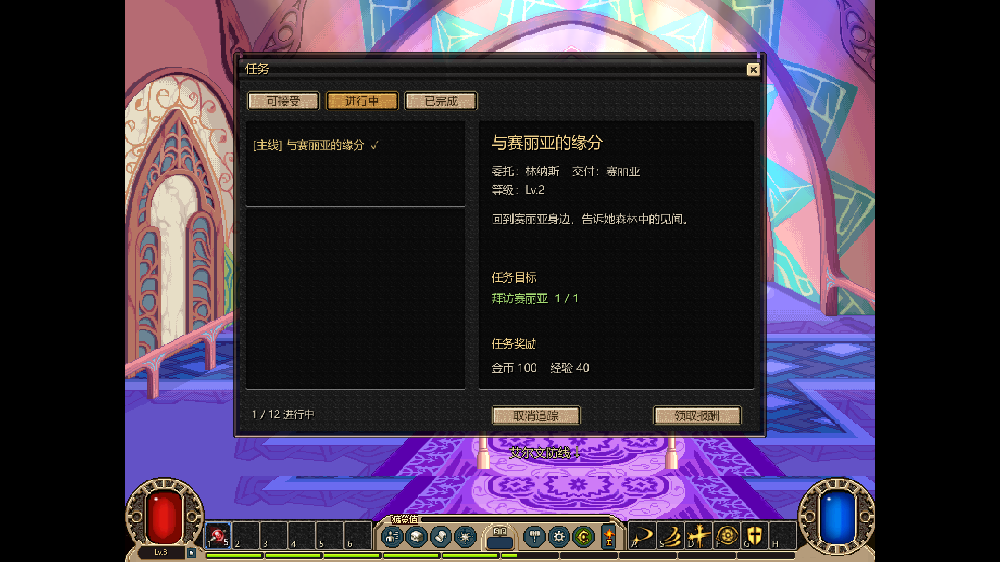

# 首批原任务闭环与共享

用户授权开搞任务首批闭环，并允许跨会话同步文件分工。设计依据为[30前期世界](../../../design/30_前期任务城镇与NPC设计.md)；补齐[31任务详细契约](../../../design/31_任务系统详细设计.md)。数值会话在83dbf7f完成后释放共享文件，任务奖励调用其公开Numbers接口；未改数值专有实现，保留用户两份project.godot改动。

## 本轮交付

- 新角色从原素材赛丽亚房间开始；E对话，向下到出口按E回艾尔文；街道原赛丽亚房屋旁按E进入。旧存档缺位置字段退回艾尔文安全点。
- 原任务101→102→103→4301：赛丽亚接取、见林纳斯、通关洛兰、洛兰深处十只普通哥布林、回赛丽亚。洛兰与深处采用各自DGN/MAP；深处原牛头兵MOB与原ANI入包，禁止缺怪后假通关。
- Q原素材任务列表：可接受/进行中/已完成、目标数、委托/交付人物、固定奖励与追踪；NPC标志与右上追踪由状态派生。对话用对应原大立绘；赛丽亚没有铁匠商店。
- 稳定语义任务键与目标键、事件去重、任务前置/等级、副本身份过滤；死亡进度即刻保存，不必等通关。奖励复用金币/背包/Numbers经验，完整候选先写盘；失败不消费、不发奖、不完成，允许重试。
- 存档2保留兼容1；旧单条委托仅迁legacy.trial，保留既得资产，不伪造原主线进度。旧进行中委托可从地图页继续旧试炼。

## 原包与适配边界

来源为完整库中的备份PVF和对应IMG/ANI，尚未认证实际生效客户端优先级。源QST的原ID/路径/SHA见运行quests.json的source；关系、NPC与目标参数沿用本轮取证。金币/XP/药剂奖励、对白、任务容量、固定房间选择是E-ADAPT配置，不冒称原版精确数值。

房间选用(r)gate.map与经典npc_se.ani；备份叠加的缺失节日装饰/dummy图块及非副本门诊断保留并明确省略。大型房间背景、赛丽亚四帧、199×247原大立绘、洛兰/深处168×80中文选图卡均保持源像素。HUD后仅延展原地面末48像素，避免透明HUD露出黑带。

牛头兵第一攻击接通现有通用AI；完整冲撞/霸体与专属受击音效未还原。原MAP图层、背景/遮挡在部分房间仍能见到黑底缺口，原版本同条件画面和完整碰撞语义仍待继续对照；本批不能当作整个原版表现已验收。

## 验证快照

Godot 4.7.2，独立临时角色，未改玩家存档。下表是本次过程快照；现行质量基线见[看板](../../../project/01_进度看板.md)。

| 验证 | 结果 |
|---|---|
| 任务纯模块 | 45项，前置、错误NPC/距离、副本、重复事件/奖励、消费/选奖、迁移及错误配置，全部通过 |
| 原任务实际循环 | 43项，真实物理按键和真实伤害/房门完成两副本；含磁盘失败全回退、零击杀XP时保存进度、重载与原牛头兵生成；全部通过 |
| 原任务真实渲染 | 同一循环通过，11张1920×1080帧缓冲；检查原大立绘、列表、难度贴格、中文与HUD地面 |
| 原样板完整循环 | 315项通过，保留旧委托回归，未把它作为原主线证据 |
| 数值核心 / 独立战斗 | 59项 / 143项通过 |
| 资源与原图 | 新资源4项测试通过，含全部新增PNG与源IMG字节对照、源路线/领主位置与MOB覆盖；既有资源测试4项通过 |
| 静态 | 中文/模块依赖/数值配置/文档检查通过 |
| 无完整库新消费端 | 新缓存从远端获取原运行底包61文件及v11的562文件；无library_v1、无本机combat构建标记，通过复制源码的正式入口43项完整任务循环 |

技术与画面检查不替代用户对美术、手感、原版一致性的最终验收。测试通关没有改敌人血量、伪造死亡、跳房或直接触发胜利。

## 实机截图









## 各区接入

资源发布[dnf-loop-v11-quests-20261023](https://github.com/mkkzzz/dnflike-assets/releases/tag/dnf-loop-v11-quests-20261023)，私有库权限沿用既有协作；flow_v1、combat_runtime、evidence逐包SHA与远端digest一致。全部新原图和编译内容随包提供，使用者不需要完整原版库。当前精确哈希以game_dnf/flow_store.json为准。

```powershell
git pull --rebase
python tools/sync_dnf_flow.py
tools/run_dnf_loop.ps1
```

Q任务，E交互，O属性，K技能，P调试，F11全屏；新角色会进赛丽亚房间。已有角色可去艾尔文的赛丽亚房屋接第一条主线，原任务不自动代做。

复现任务闭环：tools/run_dnf_loop.ps1 -Test -QuestsOnly；加-Capture采帧。完整库制作端可以-BuildAssets重建，生成器为tools/build_dnf_quest_assets.py，不能把本机绝对路径写成跨区依赖。

## 后续

先由用户复核新角色到洛兰深处这段，再按30号批次推进赫顿街区与G.S.D等NPC、收集/分解与转职。首批定义和事务可扩展，职业互斥/重复周期/掉落/特殊地图事件/有限容量投递仍未实现；不能直接批量启用所有原QST。
