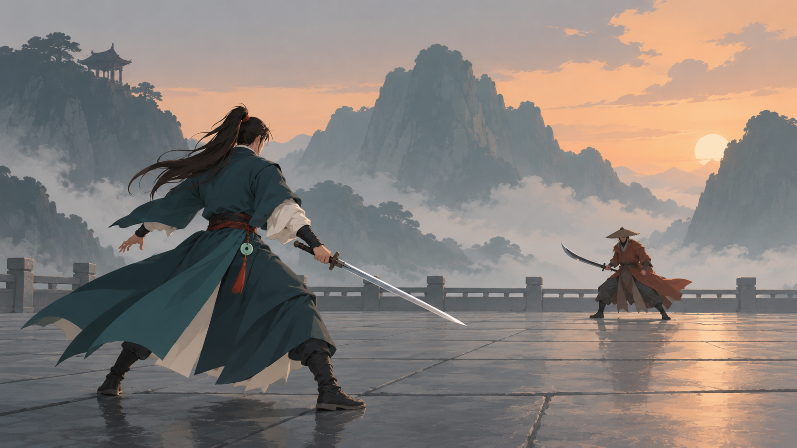
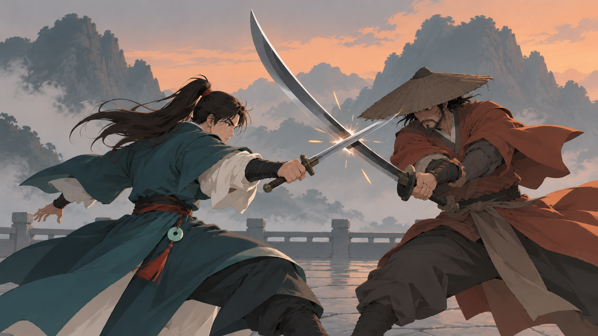

# 武侠战斗构图样图 V3

2026-10-14。状态：`source_review`，**两张候选已生成，待用户评审，未实装**。本轮保留 V2 的侠客气质和镜头对抗，降低细节密度，验证更适合二维游戏画面的美术方向。

## 需求、版本和依赖

| 字段 | 约定 |
|---|---|
| task_id / revision | wuxia_backview / v3 |
| asset_id | concept.battle.rear_view.idle；concept.battle.rear_view.weapon_parry |
| 类型 / 路线 | 静态概念图；美术全流程 A/F 组合样张 |
| 候选风格 / 题材 | wuxia_game_readable_v3 / wuxia_ink_v1 |
| 范围 | 对峙和拼刀各一张；方向评审，没有动画、分层或实装 |
| 制作工作区 | D:/dnf like/dnflike，用户本轮明确要求继续迭代 |
| 依赖 | V2 的人物与姿态参考、用户截图的近大远小构图 |
| 替代关系 | V2 的候选迭代，保留旧版本；本轮不继承批准 |
| 下游 | 若认可，需再制作角色标准板、动作短序列、场景与FX分层 |

用户原意：“有点ai味太重了，画面细节过多，不像游戏的画面，不过帅是挺帅的，再迭代一版呢”。肯定帅气不等于 V2 整套画风获批；本轮保留气质，重新评审细节密度和游戏可读性。

## 规格与设计约束

- 人物：正常成人比例、利落侠客脸型与持剑蓄势；衣装收成外袍/内衣/腰带/少量飘带，完整衣摆、约六处主要结构褶皱。黑发以大束组织，不画满零碎发丝和绳结。
- 渲染：主体用明确底色、主要阴影与克制高光，允许大面内少量渐变；保留成熟、帅气的形体，避免幼态卡通和粗黑描边。减少微纹理、碎反光、HDR、景深和光晕。
- 对峙：背后三分之四机位，主角左侧近景，目标约占画面高度 66–70%，敌人约 24–27%；中间有可读、干净的战斗地面。
- 场景：几块大石板、低栏杆、一处亭子，远山用约三层大色块与墨色过渡；降低背景对比，不用重复密集的山峰、瓦石和建筑制造复杂度。
- 拼刀：近景低机位，双方肩臂和身体施力方向清楚，握柄/护手/刃线连续，保留接触张力。火星收成少量短线，集中在真实交刃点，衣发动势以几条大曲线表达。
- 输出：16:9 静态 PNG、背景不透明；实际像素由工具结果记录。不声明已有 root/锚点/时钟/混合或运行时镜头契约。

## 真实参考与制作方法

| 输入 | 用途 | 是否传入 |
|---|---|---|
| docs/previews/wuxia_backview_v2/idle_standoff.png | V2 人物气质与动作；不延续过密渲染 | 对峙初试实际传入 |
| art/explorations/themes/wuxia/backview_v2/reference_composition.png | 用户截图，只参考镜头、主体比例和空地，不复制人物/UI | 对峙初试实际传入 |
| art/explorations/themes/wuxia/backview_v3/idle_attempt01.png | 针对初试再次强化大形简化 | 对峙选用图重绘实际传入 |
| V3 本轮对峙原图 | 同轮人物、简化衣装和场景连续性 | 拼刀图实际传入 |

使用内置 imagegen 做参考图重绘；源图、完整实际提示词、真实输入、返回路径及核查保存到 `art/explorations/themes/wuxia/backview_v3/generation.json`。模型版本与随机种子未暴露，不承诺跨图严格一致或随机生图可重现。

源图保存在 `art/explorations/themes/wuxia/backview_v3/`；评审副本保存在 `docs/previews/wuxia_backview_v3/`。副本从选用原图逐字节复制，脚本不修补、滤镜化、降色或锐化。

## 验收与交接

- [x] 两张候选生成完成，直接展示并提供准确本地路径。
- [x] 格式/真实尺寸读取成功，源与预览 SHA256 一致。
- [x] 看图核对细节密度、大形、武器、侠客气质与拼刀力量感。
- [ ] 用户认可本轮画风及构图，或指定下一轮调整。
- [ ] 获方向认可后再安排角色标准板与连续动作试点。
- [ ] 明确实装任务后再接入并录制真实游戏验收。

## 结果与评审入口

本工作区目录：`D:/dnf like/dnflike/docs/previews/wuxia_backview_v3/`。

| 评审图 | 本轮变化 |
|---|---|
| [对峙](../../previews/wuxia_backview_v3/idle_standoff.png) | 主角约占画面高度 68%，衣发大形、较完整衣摆、规整石板和安静的分层山景 |
| [拼刀](../../previews/wuxia_backview_v3/weapon_parry.png) | 保留双方肩臂承压与交刃点，减少服装纹理、碎边和火星，强化清楚的色块 |

两张均为 **1672×941 RGB PNG**，System.Drawing 实际解码成功；源/预览 SHA256 分别一致，未做脚本滤镜、重采样或像素修补。

对峙初试仍过细，保留为 `art/explorations/themes/wuxia/backview_v3/idle_attempt01.png` 并标为未选用；再次按大形简化重绘后选择当前对峙。全三次调用提示词和真实输入见 `generation.json`。

已知限制：山云仍有一定插画质感；没有数值指标能证明“AI味”消除，本轮按视觉对比记录简化结果。近景拼刀裁掉下肢末端，尚不能验证完整脚步和连续发力；主角剑尖与斗笠前缘局部重叠，轮廓不如交刃点清楚。敌人双手握同一刀柄辅助承压，不是多余武器。是否达到用户希望的游戏画面，仍待其评审。

本轮只制作候选概念；游戏工作区中的其他实装改动不属于本图像任务。发布时仅提交本轮资源及其记录，按 AGENTS 自动推送。
